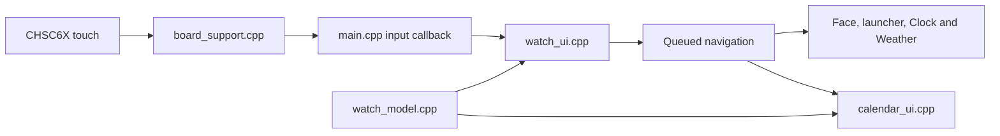
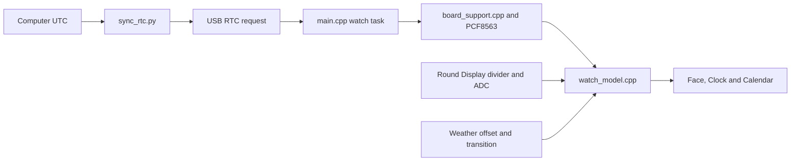
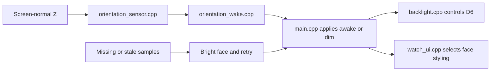
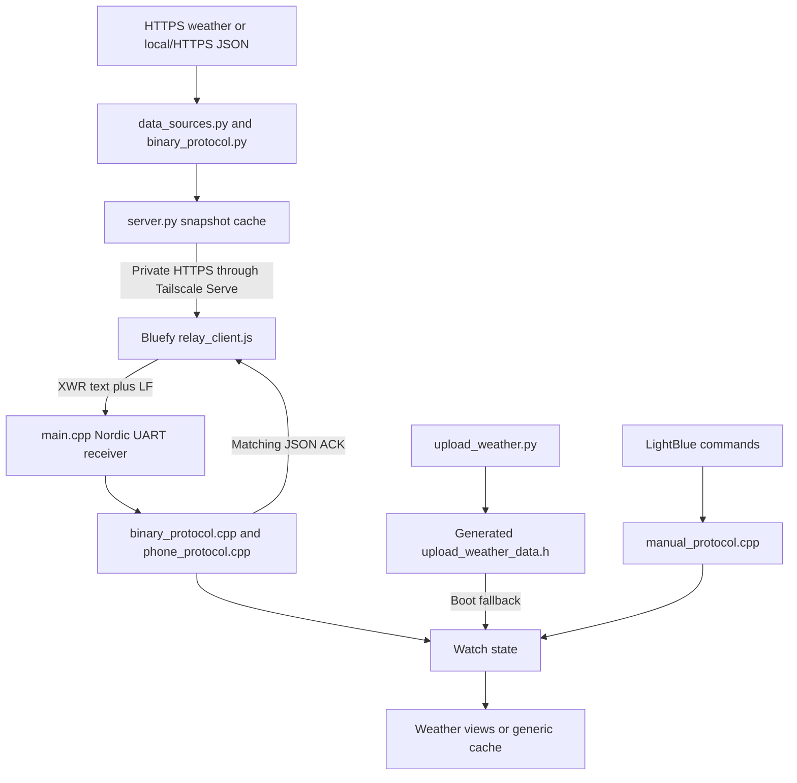
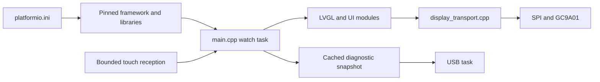

# XIAO smartwatch

This project combines a Seeed Studio XIAO nRF52840 Sense with the Round Display for XIAO to keep time locally and show information received through a phone. The watch presents an analog face, a clock application, weather forecasts and a calendar. The intended information set covers time, date, year, day of week, weather, temperature, watch battery level and soccer information. Soccer data and its interface remain unimplemented.

The display's PCF8563 calendar RTC maintains UTC independently of the phone. During firmware upload, [platformio_weather.py](project/tools/platformio_weather.py) calls [upload_weather.py](project/tools/upload_weather.py) to fetch and embed weather. For subsequent updates, [server.py](relay/browser/server.py) serves XWR v1 binary packets through a private Tailscale HTTPS connection to the existing Bluefy iPhone browser. [relay_client.js](relay/browser/relay_client.js) forwards the packets to the watch through Bluetooth Nordic UART. [binary_protocol.py](relay/binary_protocol.py) and [binary_protocol.cpp](project/src/binary_protocol.cpp) validate the same typed data format. The watch has no direct internet connection. Its stored forecast has a finite lifetime.

PlatformIO manages the firmware, Arduino framework and pinned dependencies. The configured and physically exercised target is the XIAO nRF52840 Sense with the Round Display. Windows has been used for builds, uploads and the PC relay server. The instructions below cover the corresponding macOS and Linux workflows, which have not been validated on this project. Other boards require the adaptations described under [Board adaptation](#board-adaptation).

## Instructions

### Hardware and power

Connect the XIAO Sense to the Round Display with the header orientation shown in Seeed's [assembly guide](https://wiki.seeedstudio.com/get_start_round_display/). Disconnect power before changing the assembly. Use a USB data cable for programming and diagnostics. The assembled watch used for verification has USB power and no main rechargeable battery connected.

Keep both KE switches on for this configuration. Switch 1 connects A0 to the battery-voltage measurement circuit, and switch 2 connects D6 to backlight control. A black screen theme alone does not lower the backlight when switch 2 disconnects that control. The display's separate CR927 backup cell is needed to retain RTC time when its main supply disappears; backup-cell presence and complete power-loss retention have not been verified on the assembled watch. See the [Round Display hardware guide](https://wiki.seeedstudio.com/seeedstudio_round_display_usage/) for the board's power and switch arrangement.

[board_support.cpp](project/src/board_support.cpp) reads the Round Display battery divider rather than the XIAO's separate battery interface. [watch_model.cpp](project/src/watch_model.cpp) converts voltage to a percentage that estimates a resting cell's charge and cannot establish whether a battery is attached. USB or charging conditions can affect the reading. Battery chemistry, connector polarity and board revision must be checked before adding a cell; the project's battery model, capacity and runtime remain unspecified.

### Development environment on Windows, macOS and Linux

Install Git and the desktop version of Visual Studio Code, then install the official [PlatformIO IDE extension](https://docs.platformio.org/en/latest/integration/ide/vscode.html). Allow its PlatformIO Core setup to finish. Git must be available because the platform and two libraries are pinned to repository commits. Linux installations need Python virtual-environment support; Debian and Ubuntu provide it through `python3-venv`. Use Python 3.9 or newer for `upload_weather.py`, `sync_rtc.py` and `server.py`; the [pinned platform](https://raw.githubusercontent.com/Seeed-Studio/platform-seeedboards/fe48609c542e3c66173def2e89ca1fb92058300d/platform.json) requires PlatformIO Core 6.1.16 or newer. Open the [project](project/) directory, which contains [platformio.ini](project/platformio.ini), and open the PlatformIO Core CLI terminal. Run the firmware commands in this section from that directory.

The same `pio` commands apply in PowerShell, macOS Terminal and a Linux shell when PlatformIO's executable is on the terminal's path. A default extension installation places the executables at the locations below. Custom installations can use different paths; `pio system info` identifies the active Python environment. PlatformIO documents [shell integration](https://docs.platformio.org/en/latest/core/installation/shell-commands.html) separately.

| Host shell | Default PlatformIO executable | Default Python executable |
| --- | --- | --- |
| Windows PowerShell | `$env:USERPROFILE\.platformio\penv\Scripts\pio.exe` runs the CLI. | `$env:USERPROFILE\.platformio\penv\Scripts\python.exe` runs the helpers. |
| macOS Terminal | `$HOME/.platformio/penv/bin/pio` runs the CLI. | `$HOME/.platformio/penv/bin/python` runs the helpers. |
| Linux shell | `$HOME/.platformio/penv/bin/pio` runs the CLI. | `$HOME/.platformio/penv/bin/python` runs the helpers. |

On Linux, apply PlatformIO's [udev and serial-port access instructions](https://docs.platformio.org/en/latest/core/installation/udev-rules.html) if the device is visible but the account cannot open it. Serial-access groups vary between distributions. Reconnect the board after changing rules, and sign out and back in after changing group membership. Run normal builds and uploads as the regular user rather than as root.

The following Linux commands install and reload the official device-access rules. If permission remains missing, inspect the actual serial device with `ls -l /dev/ttyACM0` and apply the group-membership procedure for the distribution and reported group.

```bash
curl -fsSL https://raw.githubusercontent.com/platformio/platformio-core/develop/platformio/assets/system/99-platformio-udev.rules | sudo tee /etc/udev/rules.d/99-platformio-udev.rules
sudo udevadm control --reload-rules
sudo udevadm trigger
```

Host architecture also affects the pinned compiler package. No Intel or Apple silicon Mac has been used to validate this checkout. If macOS reports that a selected tool requires Intel compatibility, consult [Apple's Rosetta instructions](https://support.apple.com/en-us/102527) for that system; a replacement toolchain needs its own build validation.

Use the operating system's application serial port reported by `pio device list`. Windows commonly presents a `COM` port, macOS a `/dev/cu.usbmodem...` device, and Linux a `/dev/ttyACM...` device. These names are examples. The bootloader and application may enumerate under different names.

```text
pio --version
git --version
pio system info
pio device list
pio run -e seeed_xiao_nrf52840_sense
```

The initial build downloads the toolchain and libraries selected in [platformio.ini](project/platformio.ini). On later plain builds, `upload_weather.py` loads `.pio/weather/last_upload.json` when valid, or generates an unavailable snapshot when no usable cache exists. Plain builds do not fetch new weather or set the RTC. `platformio.ini` selects Seeed's Adafruit-derived nRF52 framework; installing an Arduino IDE board package is unnecessary.

### Upload and RTC provisioning

Close serial monitors before uploading. Keep the computer's clock correct and connect only one matching watch while using automatic RTC discovery. The `extra_scripts` setting in [platformio.ini](project/platformio.ini) registers [platformio_weather.py](project/tools/platformio_weather.py) before the build and [platformio_rtc.py](project/tools/platformio_rtc.py) after upload. The weather hook calls `upload_weather.py` to fetch fresh data for ZIP 10018, validate it and embed 24 hourly records and seven daily summaries. After flashing, the RTC hook runs [sync_rtc.py](project/tools/sync_rtc.py) to write and verify fresh computer UTC through USB.

```text
pio run -e seeed_xiao_nrf52840_sense -t upload
```

An upload fails if `upload_weather.py` cannot fetch or validate fresh weather. Do not combine upload with `nobuild` or `clean`; run a clean separately when needed. The post-upload action in `platformio_rtc.py` can also fail after flashing has succeeded, for example when another application holds the serial port. Its error message distinguishes that case. The RTC does not receive compilation time on reboot.

Use `--upload-port` with the actual device name when uploader discovery is ambiguous. The examples below show the option's spelling for each host; substitute the name reported on that computer. This option selects the uploader's port. `sync_rtc.py`, invoked by `platformio_rtc.py`, rediscovers the application independently.

```powershell
pio run -e seeed_xiao_nrf52840_sense -t upload --upload-port COM5
```

```bash
pio run -e seeed_xiao_nrf52840_sense -t upload --upload-port /dev/cu.usbmodemXXXX
```

```bash
pio run -e seeed_xiao_nrf52840_sense -t upload --upload-port /dev/ttyACM0
```

If the application port does not return, follow Seeed's [XIAO nRF52840 recovery instructions](https://wiki.seeedstudio.com/XIAO_BLE/) to enter the bootloader with a double reset, then retry a normal PlatformIO upload against the newly enumerated port. Do not treat the bootloader port as the running application's RTC endpoint.

The standalone [sync_rtc.py](project/tools/sync_rtc.py) helper provisions the clock without reflashing or refreshing weather. From `project/`, run the following PowerShell command on Windows, or the following shell command on macOS and Linux. Both use PlatformIO's Python so that the serial dependency is available.

```powershell
& "$env:USERPROFILE\.platformio\penv\Scripts\python.exe" tools/sync_rtc.py
```

```bash
"$HOME/.platformio/penv/bin/python" tools/sync_rtc.py
```

Append `--port COM5`, `--port /dev/cu.usbmodemXXXX` or `--port /dev/ttyACM0` to select the actual application port. `sync_rtc.py` still requires USB VID `2886` and PID `8045`; a port argument does not override those checks. It reads the host clock independently of the host's timezone, checks RTC readback and confirms that the hardware clock advances. A valid backed-up RTC continues after USB is removed.

The build outputs appear under `project/.pio/build/seeed_xiao_nrf52840_sense/`. `firmware.hex` contains the application image, `firmware.zip` packages the serial DFU application, and `firmware.elf` contains the linked executable and symbols. These artifacts are specific to this target and its bootloader/SoftDevice layout. Normal PlatformIO upload remains the supported route because it also refreshes weather and provisions the RTC.

### Operating the watch and receiving updates

Hold the screen upward to wake the white interface. Tap an unused part of the face to open the scrolling launcher, or tap the date and weather complications to open their applications directly. The shortcuts shrink briefly before navigation. Return arrows lead from an application to the launcher and from the launcher to the face. Calendar navigation stays within 2026. Weather provides separate 24-hour and seven-day tabs with scrollable forecasts.

The Weather header displays the data's fetch time as `Updated MM/DD/YY HH:MM:SS`. It does not substitute the running clock. A tilde on the face marks a prediction or an upload snapshot displayed before clock validity is known; unavailable information remains `--`. The watch derives display time from RTC UTC plus the offset and next daylight-saving transition supplied with weather. Stored coverage is not extended when the PC server stops.

Install [Bluefy](https://apps.apple.com/us/app/bluefy-web-ble-browser/id1492822055) and [Tailscale](https://tailscale.com/download) on the iPhone, and install Tailscale on the PC. Connect both devices to the same personal Tailscale network. The [relay setup guide](relay/browser/README.md) covers account sign-in, HTTPS approval, source configuration and connection recovery. Bluefy provides the browser Bluetooth interface; Tailscale carries HTTPS between the phone and PC. The PC can remain at home while the phone stays within Bluetooth range of the watch.

From the repository root on Windows, start the weather server with [manage_pc.ps1](relay/browser/manage_pc.ps1), then configure the private HTTPS proxy. The manager uses the installed PlatformIO Python, runs the server hidden and preserves its access token across restarts. Tailscale may open an account approval page before enabling HTTPS.

```powershell
powershell.exe -NoProfile -ExecutionPolicy Bypass -File .\relay\browser\manage_pc.ps1 -Action Start
& "$env:ProgramFiles\Tailscale\tailscale.exe" serve --bg http://127.0.0.1:8765
& "$env:ProgramFiles\Tailscale\tailscale.exe" serve status
```

On macOS or Linux, run [server.py](relay/browser/server.py) in a terminal with Python 3.9 or newer. Leave that process running and configure Tailscale Serve from another terminal. The `tailscale` command must resolve to the installed Tailscale CLI; the [browser guide](relay/browser/README.md) includes the macOS application-bundle path where needed.

```sh
python3 -B relay/browser/server.py --host 127.0.0.1 --port 8765 --weather
```

```sh
tailscale serve --bg http://127.0.0.1:8765
tailscale serve status
```

Open the HTTPS address reported by Serve in Bluefy while the iPhone's Tailscale connection is enabled. Read `relay/browser/.local/access_token.txt` locally on the PC, enter its value in the page and tap Use token. Tap Connect watch or Reconnect watch and select XIAO Watch when prompted. The page retains the token in memory only, so enter it again after a reload. Applied means the watch accepted a new topic sequence; Already accepted means it returned a duplicate acknowledgement for that sequence. Keep the saved iPhone pairing. Reconnect watch reuses the permitted device, while Choose watch requests a new selection.

[server.py](relay/browser/server.py) fetches weather or generic JSON immediately and then every 900 seconds. [relay_client.js](relay/browser/relay_client.js) checks the authenticated snapshot every 30 seconds while visible and again on resume. The PC must remain awake and online. Dependable delivery requires the Bluefy relay page to stay active; locking the phone or switching apps can suspend it. Unlocking while using another app does not trigger this page. The server's snapshot expires after 900 seconds without a valid refresh, and unsuccessful transfers do not extend the forecast.

After restarting Windows, sign in, ensure Tailscale is connected and run the same `manage_pc.ps1 -Action Start` command. Check it with `-Action Status`. The manager does not install a startup task. [Tailscale Serve with `--bg`](https://tailscale.com/docs/reference/tailscale-cli/serve#effects-of-rebooting-and-restarting) preserves the proxy configuration across restarts, but it does not start the Python server. macOS and Linux also require restarting `server.py` unless a separate service has been configured. Return to the relay page in Bluefy and reconnect as needed.

A 192-byte weather packet reached the watch through Bluefy on October 20, 2026, with matching server and watch sequence, 24 hourly records and seven daily records. The next scheduled PC snapshot also reached the watch. A subsequent page reload and Disconnect/Reconnect both passed with the iPhone pairing intact. Those connection checks preceded removal of the unused notification receiver. The replacement firmware subsequently built and uploaded with fresh weather, and USB provisioning verified an advancing RTC. Bluefy subsequently accepted weather on that firmware after reconnection with the saved pairing. USB diagnostics matched the server sequence `1792546424`, with 24 hourly records and seven daily records. Long-duration delivery and locked-phone operation remain unverified.

### Relay format and parser use

[data_sources.py](relay/data_sources.py) validates JSON from files and HTTPS sources, then calls [binary_protocol.py](relay/binary_protocol.py) to encode XWR v1. Each `XW1:` body contains canonical Base64 of a binary packet with a version, codec, UTC sequence, topic, lengths and CRC32. `pack_weather()` preserves current conditions, 24 hourly records and seven daily summaries. Generic values support null, booleans, signed integers, finite floating-point numbers, UTF-8 text, arrays, string-keyed maps and opaque bytes. Encoding a new topic does not add an application; a consumer must interpret the cached payload.

| Layer | Size and purpose |
| --- | --- |
| Source JSON has a separate input bound. | The source reader accepts at most 256 KiB from a file or HTTPS response before validating and encoding the content. That bound does not describe Bluetooth packet capacity. |
| An XWR packet contains metadata and data. | The complete decoded packet fits within 189 bytes. Its header and CRC occupy 15 bytes, so a generic payload has at most `174 - topic_length` encoded bytes, including its type and length fields. |
| Text framing carries one packet. | The current XWR implementation caps its complete `XW1:` body at 256 ASCII bytes. The browser adds LF and splits that frame into acknowledged writes of at most 20 bytes. It does not split oversized data into multiple XWR packets. |
| Weather uses a dedicated representation. | Its 118-byte payload produces a 140-byte packet and a 192-byte text body before LF. |

The Python parser [binary_protocol.py](relay/binary_protocol.py) can inspect a saved body without publishing or connecting to the watch. From the repository root, replace `message.txt` with a file containing one `XW1:` body and run the appropriate command below. The command prints a JSON diagnostic representation of the decoded packet; that output does not change the binary wire format. Add `--raw` when the input file contains raw packet bytes instead of Base64 text.

```powershell
& "$env:USERPROFILE\.platformio\penv\Scripts\python.exe" -B relay/binary_protocol.py message.txt
```

```bash
"$HOME/.platformio/penv/bin/python" -B relay/binary_protocol.py message.txt
```

[relay/PROTOCOL.md](relay/PROTOCOL.md) supplies encoder examples, a reproducible test vector and the C++ APIs declared in [binary_protocol.h](project/include/binary_protocol.h). [binary_protocol.cpp](project/src/binary_protocol.cpp) checks lengths, types, Base64 and CRC. [phone_protocol.cpp](project/src/phone_protocol.cpp) validates sequence history and weather semantics. The server and browser enforce a 900-second age limit and reject packets more than 300 seconds ahead; the UART parser does not apply that transport freshness policy itself. CRC detects accidental corruption and does not authenticate a sender. Nordic UART accepts XWR text or diagnostic JSON followed by LF, and its acknowledgements and polls remain JSON. [manual_protocol.cpp](project/src/manual_protocol.cpp) retains the separate short LightBlue command format.

### Diagnostics and recovery

Use the following command to open a serial monitor, adding the actual `--port` value when needed. Enter `?` to request cached firmware status, and close the monitor with Ctrl+C before an upload or RTC provisioning attempt. A reported access-denied error can mean that another monitor still owns the port.

```text
pio device monitor --baud 115200
```

Inspect RTC trust, loop progress, completed display flushes, touch recovery counters and `RELAY` state in the report emitted by [main.cpp](project/src/main.cpp). A successful build establishes compilation, an upload establishes programming, and a matching application acknowledgement establishes accepted data. [project/README.md](project/README.md#usb-diagnostics) describes the USB fields, while [project/LIGHTBLUE.md](project/LIGHTBLUE.md) covers optional manual settings, weather and transport checks. Bluetooth time-setting commands are absent.

For an XWR delivery, compare the topic and sequence shown by the relay page with `RELAY topic` and `seq` from [main.cpp](project/src/main.cpp), then check `WEATHER hours`, `days` and `fetched_utc`. Applied increments the relay revision; Already accepted leaves the previously applied data unchanged. `binary_v=1` reports decoder support. `generic_format` describes the generic cache and may remain `json` after a weather update, because weather uses its dedicated model. An HTTPS response or a connected Bluetooth link alone does not establish application acceptance.

If the face turns black without visibly dimming, check KE switch 2. If `SET RTC` appears, close the monitor and run [sync_rtc.py](project/tools/sync_rtc.py). If weather stops updating, check the PC process with `manage_pc.ps1 -Action Status`, confirm that Tailscale is connected on both devices and return to the relay page in Bluefy. Use Reconnect watch before trying fresh discovery. The page can reuse an authorized watch even when iOS retains its physical Bluetooth connection; routine reconnection does not require forgetting the pairing.

### Board adaptation

Seeed's [Round Display compatibility documentation](https://wiki.seeedstudio.com/get_start_round_display/) describes hardware fit across the XIAO range. The current firmware also depends on a particular core, peripheral mapping and Bluetooth stack. The table distinguishes hardware candidates from a working project configuration.

| Board family | Current project support | Required adaptation |
| --- | --- | --- |
| XIAO nRF52840 Sense | The configured board has been compiled, uploaded and exercised with the Round Display. | The existing environment uses its onboard LSM6DS3TR-C and application USB PID `8045`. |
| XIAO nRF52840 without Sense | The same processor and connector make it a porting candidate; this project has not validated it. | The board lacks the Sense IMU, so [orientation_sensor.cpp](project/src/orientation_sensor.cpp) must be disabled or adapted. Its application PID is `8044`, which `sync_rtc.py` currently rejects. |
| Another nRF52840 board | The processor provides related peripherals, but no alternative board environment is supplied. | Adapt pin mapping, bootloader/SoftDevice layout, the Adafruit-derived core dependencies, external display wiring, battery measurement and USB discovery. |
| A Bluetooth-capable XIAO using another processor | Connector compatibility does not provide compatible Nordic drivers or Bluefruit APIs. | Replace the Nordic hardware layer and BLE integration, then adapt task scheduling, USB and memory configuration. |
| A XIAO without an onboard Bluetooth radio | The current iPhone relay has no radio path on that board. | Add a compatible Bluetooth subsystem or implement another data transport, and port the hardware layer. A smaller-memory board may also require a reduced interface and data model. |

Create a separate PlatformIO environment for a port and retain the existing environment as the reference. Select the actual board's platform, core and upload protocol before changing pins. The current Seeed platform exposes `seeed-xiao-afruitnrf52-nrf52840` for the non-Sense variant, but selecting that identifier alone does not adapt the sensor or RTC discovery. Never upload the existing Sense binary to a different board merely because both use an nRF52840.

Map the Round Display signals from the target schematic into [platformio.ini](project/platformio.ini) and [board_support.cpp](project/src/board_support.cpp). The reference mapping uses D0/A0 for the battery divider, D1 for display chip select, D3 for display data/command, D4/D5 for external I2C, D6 for the backlight, D7 for touch indication, and D8/D9/D10 for SPI clock/MISO/MOSI. D2 holds the unused microSD chip select inactive. The firmware assumes a 240-by-240 GC9A01 display, touch address `0x2E` and PCF8563 address `0x51`; preserve 3.3 V signal compatibility when wiring another board.

Adapt [board_support.cpp](project/src/board_support.cpp), [orientation_sensor.cpp](project/src/orientation_sensor.cpp), [backlight.cpp](project/src/backlight.cpp) and [display_transport.cpp](project/src/display_transport.cpp) to the target peripheral ownership and ADC/PWM APIs. The current touch driver uses TWIM0, the IMU driver uses TWIM1, and the display uses the selected core's SPIM3 path. Sense-specific internal pins and sensor power drive must not be copied to unrelated hardware. An external orientation sensor requires a verified screen-normal axis and sign before applying the existing thresholds.

Preserve or replace the Bluefruit/SoftDevice, FreeRTOS and TinyUSB interfaces used by [main.cpp](project/src/main.cpp), [manual_bluetooth.cpp](project/src/manual_bluetooth.cpp). An Arduino framework choice by itself does not supply these APIs. Update the USB identity checks in [sync_rtc.py](project/tools/sync_rtc.py) for the new application identity, retaining the distinction from its bootloader. The October 20 browser-relay upload build reports 100,964 bytes of static RAM and 649,612 bytes of application flash; the linker report does not measure peak runtime memory. Smaller targets require memory work before the same interface can fit.

Build the new environment before attempting an upload, then verify display colors, touch coordinates, return navigation, RTC readback and ticking, sensor failure handling, PWM dimming and XWR application acceptance on that hardware. Check battery scaling against a meter and verify RTC backup retention with the actual power arrangement. No alternative board or host operating system has passed those project-specific hardware checks yet.

## Implementation

### Interface and navigation

[watch_ui.cpp](project/src/watch_ui.cpp) builds the face and applications using LVGL and shares the state declared in [watch_model.h](project/include/watch_model.h). [display_transport.cpp](project/src/display_transport.cpp) sends the Round Display's partial buffer. Queued navigation in `watch_ui.cpp` keeps object replacement outside touch-event dispatch, and a held contact cannot activate the next screen's controls. Clock hands can pass over the complications as they move.

| Implementation | Function and boundary | Source |
| --- | --- | --- |
| The analog face shows the time. | Black minute marks and hour/minute hands use a white background, while the second hand is red. The face has no hour numerals. | [watch_ui.cpp](project/src/watch_ui.cpp) draws the face. |
| Battery and weather occupy the face. | A colored, level-filled battery contains its percentage, and a colored weather symbol contains the temperature. The date appears below the center without a box. | [watch_ui.cpp](project/src/watch_ui.cpp) draws values selected by [watch_model.cpp](project/src/watch_model.cpp). |
| Shortcuts and the launcher route touch input. | Date and weather targets use a small ease-out shrink and open on the first contact. The launcher scrolls and retains a fixed return arrow. | [watch_ui.cpp](project/src/watch_ui.cpp) owns navigation. |
| Clock shows the current time. | The application provides a time display and return navigation without alarm, stopwatch or timer features. | [watch_ui.cpp](project/src/watch_ui.cpp) builds the Clock view. |
| Calendar displays 2026. | Month navigation stays between January and December, and a valid matching date controls the current-day highlight. | [calendar_ui.cpp](project/src/calendar_ui.cpp) owns the calendar. |
| Weather shows dated forecasts. | The two tabs show hourly conditions or daily modal icons with minimum/maximum temperatures, plus the fetch-time header. | [watch_ui.cpp](project/src/watch_ui.cpp) builds the forecast views. |



### Time and battery state

[board_support.cpp](project/src/board_support.cpp) reads calendar UTC from the PCF8563, while [watch_model.cpp](project/src/watch_model.cpp) applies the display offset separately. [main.cpp](project/src/main.cpp) schedules RTC reads at boot and once per second; `watch_model.cpp` interpolates between samples. A transient read failure retains the local estimate, and a later valid sample restores RTC trust. Underlying RTC Wire transfers still lack an in-transfer timeout.

| Implementation | Function and boundary | Source |
| --- | --- | --- |
| USB provisions the RTC. | The post-upload helper writes fresh host UTC, verifies readback and observes ticking within the supported 2000–2099 range. | [platformio_rtc.py](project/tools/platformio_rtc.py), [sync_rtc.py](project/tools/sync_rtc.py) and [rtc_usb_protocol.cpp](project/src/rtc_usb_protocol.cpp) handle provisioning. |
| The model maintains local display time. | Validated UTC, an offset and one recorded transition produce calendar fields without resetting the RTC on reboot. | [watch_model.cpp](project/src/watch_model.cpp) converts time. |
| The board samples battery voltage. | A 12-bit ADC with a 3.0 V range and 40 μs acquisition averages 16 samples through the display's 470 kΩ/470 kΩ divider. | [board_support.cpp](project/src/board_support.cpp) measures voltage. |
| The model estimates charge and colors. | Invalid voltage yields an unknown level. The percentage remains a voltage estimate rather than a measured remaining capacity. | [watch_model.cpp](project/src/watch_model.cpp) selects percentage and color. |



### Orientation and backlight

Only the accelerometer's screen-normal Z axis controls wake behavior. [orientation_sensor.cpp](project/src/orientation_sensor.cpp) reads Z and applies the mounting sign so that a stationary, upward-facing screen reads approximately +1000 mg. [orientation_wake.cpp](project/src/orientation_wake.cpp) filters that reading and selects the wake state. Motion can change the value, so the angle interpretation applies to a gravity-dominated reading.

| Implementation | Function and boundary | Source |
| --- | --- | --- |
| The sensor driver reads Z. | The LSM6DS3TR-C runs at 26 Hz in its low-power ±2 g mode, while the watch polls at 40 ms intervals. | [orientation_sensor.cpp](project/src/orientation_sensor.cpp) owns the internal bus. |
| A filtered policy selects wake or dim. | A 30 ms filter, 40 ms wake hold and 80 ms dim hold use thresholds of 819 mg and 707 mg, corresponding to about 35° and 45° at rest. The intervening band preserves state. | [orientation_wake.cpp](project/src/orientation_wake.cpp) applies the policy. |
| PWM changes the backlight duty. | Awake mode uses 255/255 duty and dim mode uses 10/255. This changes the display rather than putting the processor into deep sleep. | [backlight.cpp](project/src/backlight.cpp) owns a core hardware PWM channel. |
| The dim view limits interaction. | A black face retains white marks and hour/minute hands plus the red second hand. Complications and controls disappear, and touch cannot wake or navigate. | [main.cpp](project/src/main.cpp) and [watch_ui.cpp](project/src/watch_ui.cpp) apply state changes. |
| Failure restores visibility. | Missing or stale sensor data restores the bright interface; initialization retries every five seconds. Both orientation transitions return to the face. | [main.cpp](project/src/main.cpp) coordinates recovery. |



### Weather and generic data

[upload_weather.py](project/tools/upload_weather.py) normalizes Open-Meteo data for ZIP 10018 at latitude 40.7547 and longitude −73.9925 in `America/New_York`. Its `normalize()` function stores Celsius, 24 hourly forecasts and today plus six subsequent local dates. It selects each daily icon from the most frequent hourly icon group, with the first occurrence resolving a tie. Day boundaries retain daylight-saving changes. Open-Meteo data carries [CC BY 4.0 attribution](https://open-meteo.com/en/docs).

| Implementation | Function and boundary | Source |
| --- | --- | --- |
| Upload embeds a fallback. | Upload targets require a fresh validated fetch; plain builds may reuse the cache without changing its timestamp. Reboot restores the embedded snapshot. | [platformio_weather.py](project/tools/platformio_weather.py) calls [upload_weather.py](project/tools/upload_weather.py). |
| The source adapter encodes relay packets. | A file, an HTTPS JSON source or the weather adapter supplies an XWR packet with a topic, sequence, codec and CRC32. | [data_sources.py](relay/data_sources.py) validates inputs, while [binary_protocol.py](relay/binary_protocol.py) encodes and parses. |
| Compact weather preserves the forecast. | Its 118-byte payload occupies a 140-byte packet and 192-byte text body. Decoding preserves temperatures in tenths, WMO codes and time metadata. | [packed_weather.cpp](project/src/packed_weather.cpp) decodes weather. |
| The PC exposes an authenticated snapshot. | Sources refresh as one validated batch every 900 seconds, and expired data is unavailable for new delivery. Tailscale Serve provides private HTTPS to the loopback server. | [server.py](relay/browser/server.py) owns the snapshot and endpoint. |
| Bluefy forwards packets over Bluetooth. | The active page checks for updates, sends bounded UART writes and requires a matching application acknowledgement. Saved-device recovery preserves the iPhone pairing. | [relay_client.js](relay/browser/relay_client.js) and [relay_protocol.js](relay/browser/relay_protocol.js) implement delivery. |
| Binary parsers expose typed data. | Python encodes and decodes packets. The allocation-free C++ parser exposes views into caller-owned buffers that must remain alive and unchanged. | [binary_protocol.py](relay/binary_protocol.py), [binary_protocol.h](project/include/binary_protocol.h) and [binary_protocol.cpp](project/src/binary_protocol.cpp) define the APIs. |
| Application validation protects existing state. | Rejected input preserves the model and sequence history. History tracks eight topics per physical BLE connection; unknown topics share one latest-payload cache with an explicit encoding field. | [strict_json.cpp](project/src/strict_json.cpp) and [phone_protocol.cpp](project/src/phone_protocol.cpp) validate and apply data. |
| Manual diagnostics support short commands. | LightBlue can select units and stage weather through a separate service. Neither that service nor Nordic UART sets RTC time. | [manual_protocol.cpp](project/src/manual_protocol.cpp) and [manual_bluetooth.cpp](project/src/manual_bluetooth.cpp) handle manual commands. |



### Build, rendering and execution

The watch task in [main.cpp](project/src/main.cpp) owns LVGL, the shared model and board-facing operations. Bluetooth callbacks in `main.cpp` and [manual_bluetooth.cpp](project/src/manual_bluetooth.cpp) pass bounded work to task context. The USB task in `main.cpp` reports cached status rather than accessing the display or I2C bus concurrently. [display_transport.cpp](project/src/display_transport.cpp) uses the core's SPI implementation to avoid an unrelated vendor DMA wait on SPIM0.

| Implementation | Function and boundary | Source |
| --- | --- | --- |
| PlatformIO pins the platform and libraries. | The configuration selects the Sense board and retains the five external dependencies shown below. Framework Bluetooth and USB support remain bundled. | [platformio.ini](project/platformio.ini) defines the build. |
| The display sends partial RGB565 rectangles. | A 4,800-byte buffer feeds blocking TX-only SPI transfers at 8 MHz, with bounds checks and byte-order restoration. | [display_transport.cpp](project/src/display_transport.cpp) handles flushes. |
| Touch reception has bounded waits. | TWIM0 receives a five-byte report with 10 ms receive and 5 ms STOP deadlines; failed transfers cancel the gesture and attempt bus recovery. | [board_support.cpp](project/src/board_support.cpp) reads touch. |
| Task ownership separates peripheral access. | The watch task processes hardware and UI work, while USB serves status and queued RTC requests. BLE callbacks queue bounded input. | [main.cpp](project/src/main.cpp) coordinates tasks. |
| USB exposes operating state. | Reports include RTC trust, progress counters, display/touch errors, orientation, backlight and accepted relay metadata. They omit arbitrary payload bodies. | [main.cpp](project/src/main.cpp) emits diagnostics. |

| Dependency | Pinned selection and purpose |
| --- | --- |
| Seeed_GFX | Commit `0dfdd7135425be82b5bb4b4b58d74dd51ab29a59` supplies the panel initialization and graphics driver. |
| Seeed_Arduino_RoundDisplay | Commit `e811877f5b150981a481c39abd9c7ee0a029cd1c` supplies the display integration and partial buffer. |
| LVGL | Version `9.6.0` supplies widgets, input dispatch and rendering. |
| ArduinoJson | Version `7.4.3` supplies bounded JSON representation alongside the project's validation. |
| RTClib | Version `2.1.4` supplies PCF8563 integration used with checked calendar transport. |



The [changelog](CHANGELOG.md) records dated changes. The [firmware guide](project/README.md), [LightBlue guide](project/LIGHTBLUE.md), [relay guide](relay/README.md), [browser relay guide](relay/browser/README.md) and [protocol specification](relay/PROTOCOL.md) describe the corresponding operating paths in more detail.
