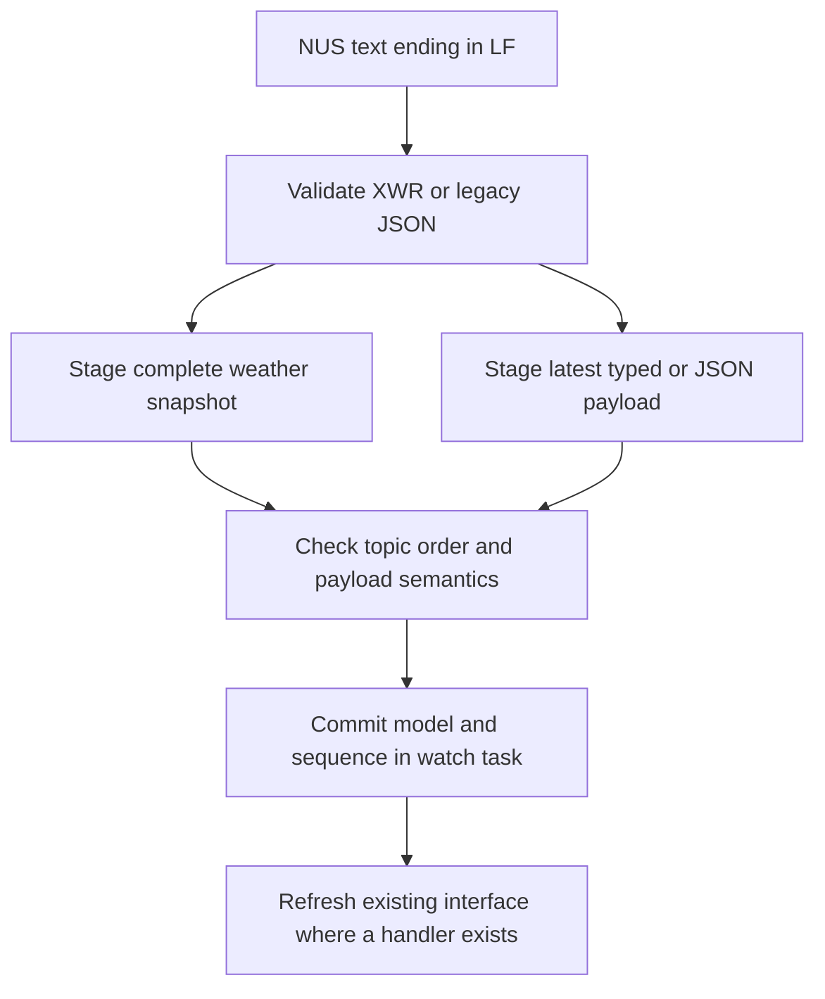

# XIAO watch firmware

This PlatformIO project runs the watch interface on a Seeed Studio XIAO nRF52840 Sense with a Seeed Studio Round Display for XIAO. The Round Display supplies the calendar RTC, touch panel and watch-battery measurement circuit. A computer supplies weather during upload, and the Bluefy iPhone relay refreshes data while the firmware runs. The watch has no direct internet connection.

The [project overview](../README.md) introduces the design, describes installation on Windows, Linux and macOS, and explains the work required for other boards. This guide covers the configured firmware, its interfaces and its diagnostics. The current apps are Clock, Weather and Calendar; soccer remains a planned feature without a selected source, league or team.

## Build and upload

Open this `project` directory in PlatformIO; [platformio.ini](platformio.ini) selects the Sense target, dependencies and upload hooks. Run the following command in a PlatformIO terminal to compile that target. The command is the same on Windows, Linux and macOS; Windows is the host on which the recorded build and upload checks ran.

```sh
pio run -e seeed_xiao_nrf52840_sense
```

A plain build uses [platformio_weather.py](tools/platformio_weather.py) to call `prepare` in [upload_weather.py](tools/upload_weather.py), which reads the validated weather cache at `.pio/weather/last_upload.json`. Without a cache, it builds a firmware image that reports unavailable weather. It does not fetch weather or write the RTC. `upload_weather.py` generates `.pio/build/seeed_xiao_nrf52840_sense/generated/upload_weather_data.h`; change generation rules in `upload_weather.py` rather than editing this generated header.

Connect the assembled watch through a USB data cable, close serial monitors and upload through PlatformIO. Keep the computer clock correct and its internet connection available during this command.

```sh
pio run -e seeed_xiao_nrf52840_sense -t upload
```

The pre-build hook in `tools/platformio_weather.py` calls `tools/upload_weather.py` to fetch and validate current conditions, 24 hourly forecasts and seven daily summaries before compilation. A failed or incomplete fetch stops the upload instead of reusing old weather. Do not combine the upload target with `nobuild` or `clean`. After flashing, [platformio_rtc.py](tools/platformio_rtc.py) calls [sync_rtc.py](tools/sync_rtc.py) to find the application USB port, write fresh computer UTC to the PCF8563 and verify that physical RTC time advances.

An RTC provisioning error can occur after flashing has succeeded. Keep USB connected, close any competing monitor and use the standalone recovery command below. When bootloader recovery is needed, double-press the XIAO reset button and identify its new port with `pio device list`; the application and bootloader can appear on different ports. A port name by itself does not establish that it belongs to the watch.

The configured upload produces `firmware.hex`, `firmware.elf` and the upload package `firmware.zip` under `.pio/build/seeed_xiao_nrf52840_sense/`. Flashing an existing artifact outside the normal PlatformIO upload retains its embedded forecast and bypasses `tools/platformio_weather.py` and `tools/platformio_rtc.py`. The normal PlatformIO upload remains the documented path for refreshing both.

## Set the hardware RTC over USB

The RTC stores UTC for years 2000 through 2099. A normal upload provisions it automatically. To set it without rebuilding or refreshing weather, run [sync_rtc.py](tools/sync_rtc.py) from this directory with PlatformIO's Python environment. For the default Windows PlatformIO installation, PowerShell uses the following command.

```powershell
& "$env:USERPROFILE\.platformio\penv\Scripts\python.exe" tools/sync_rtc.py
```

For the default Linux or macOS installation, the equivalent command uses the environment's POSIX interpreter path. Adjust either path if `PLATFORMIO_CORE_DIR` or the installation location differs.

```sh
"$HOME/.platformio/penv/bin/python" tools/sync_rtc.py
```

`sync_rtc.py` uses PlatformIO's existing pyserial dependency. It accepts `--port` followed by the current application port when more than one matching device is connected. For example, append `--port COM5` only when `pio device list` identifies that port as the watch. POSIX port names may resemble `/dev/ttyACM0` or `/dev/cu.usbmodem...`. Explicit selection still requires the configured application USB identity, VID `0x2886` and PID `0x8045`; port selection does not make this script compatible with another board.

Success reports `RTC: set from computer UTC and verified advancing`, and `sync_rtc.py` closes the port after verification. [main.cpp](src/main.cpp) schedules RTC reads through [board_support.cpp](src/board_support.cpp) at boot and once per second; [watch_model.cpp](src/watch_model.cpp) interpolates between reads and retains a ticking estimate after a transient read failure. A later valid read restores hardware time. Without any valid RTC sample, [watch_ui.cpp](src/watch_ui.cpp) shows `SET` and `RTC` on the face, and the Clock app asks for USB provisioning instead of displaying invented hands or time.

The watch preserves valid RTC contents on reboot and does not replay a compilation or weather-fetch timestamp. A working CR927 backup cell is required for RTC retention when the main supply is removed. Backup-cell presence and retention have not been verified on the current assembly. USB synchronization changes UTC only; weather snapshots and complete relay updates supply the New York display offset and its next daylight-saving transition. Without that offset, the clock displays UTC.

## Use the interface

[watch_ui.cpp](src/watch_ui.cpp) implements the face, launcher, Clock and Weather screens; [calendar_ui.cpp](src/calendar_ui.cpp) builds Calendar. The awake face uses a white background, black minute marks and hour/minute hands, and a red second hand. It has no hour numbers. The battery sits above the center, the weather symbol sits to the left, and the date appears below the center on two lines, such as `Sat` followed by `Oct 3`. The hands pass above these elements. The date has no surrounding box or outline.

| Interface | Implemented behavior |
| --- | --- |
| The battery symbol reports the watch battery. | Its fill follows the estimated level, with red through 20%, amber through 50% and green above 50%. A 10-pixel percentage appears inside the 32-by-18-pixel body at `(104, 51)`. An unavailable estimate displays `--%` in a gray symbol. |
| The weather symbol reports the selected weather value. | Its 60-by-44-pixel artwork contains a temperature near `(55, 116)`. The font falls from 12 to 10 pixels for longer values, and the degree glyph can be omitted to preserve the number and provenance marker. Weather colors remain separate from the black/red text palette. |
| The date and weather symbols act as shortcuts. | A single contact commits Calendar or Weather navigation. The artwork shrinks to about 96% over 100 ms with a fast start and slower finish, followed by a 40 ms settling interval. Larger fixed hit areas remain active, and a held finger cannot activate the next screen. |
| The Apps screen provides navigation. | Tapping elsewhere on the face opens a scrollable list with Clock, Weather and Calendar. The buttons use 14-pixel text, and the bottom return arrow stays fixed. App arrows return to Apps; its arrow returns to the face. |
| The Clock app displays time. | It shows local time as `HH:MM:SS` in 24-hour format. Alarm, timer and stopwatch functions are not implemented. |
| The Weather app displays forecasts. | The `24h` and `7 days` tabs contain scrollable dated forecasts. Each tab shows only `Updated MM/DD/YY HH:MM:SS` as header metadata, using the actual fetch timestamp and its local offset. Missing fetch time displays `Updated --/--/-- --:--:--`. |
| The Calendar app displays 2026. | Previous/next arrows browse twelve months without crossing the year boundary. Weeks begin on Sunday, Sundays use red text, and the current date receives a red highlight when the displayed month matches a valid 2026 clock date. It opens at the current month in 2026 or January otherwise; it does not edit events. |

The face uses fresh observed conditions first, then an available hourly prediction. A leading `~` marks a prediction or a stored upload snapshot shown while the clock is unset. `--` marks unavailable data. Weather labels the configured unit, while the face shows only the value and degree symbol when space permits. Celsius is the default; manual settings can select Fahrenheit without changing stored Celsius values.

Hourly rows disappear as their coverage passes. Daily rows retain their dated minimum/maximum temperatures and most common weather icon. An expired forecast does not roll forward to create new predictions, and rebooting does not refresh its timestamps. Incoming weather and settings remain in RAM; a reboot restores the embedded upload snapshot and default display units.

## Wake and dim behavior

The sensor driver in [orientation_sensor.cpp](src/orientation_sensor.cpp) reads only the LSM6DS3TR-C accelerometer's screen-normal Z axis. It leaves the gyroscope powered down and does not use microphone or local temperature measurements. The signed mounting correction makes a still, face-up screen approximately `+1000 mg`. Weather supplies the displayed temperature.

[orientation_wake.cpp](src/orientation_wake.cpp) applies the thresholds and timing declared in [orientation_wake.h](include/orientation_wake.h). Filtered acceleration of at least `819 mg`, approximately 35 degrees from face-up, wakes the interface after 40 ms. A value below `707 mg`, approximately 45 degrees, dims it after 80 ms. The filter time constant is 30 ms, and the interval between thresholds preserves the existing state. Movement also changes acceleration, so these angles describe a steady watch rather than a calibrated wrist gesture.

Dimming returns any app to a black face with white minute marks and hour/minute hands through `watch_ui.cpp`. The red second hand remains, and all complications and controls disappear. `main.cpp` selects the awake and dim levels, and [backlight.cpp](src/backlight.cpp) applies the change from `255` to `10` on an eight-bit PWM scale, approximately 4% duty cycle. This changes the display, not the MCU power state. Touch does not wake the watch, and waking returns to the face after discarding pending navigation. A finger held across the transition must be released before another tap.

Both KE switches must remain ON for the assembled watch: KE1 connects A0 battery measurement, and KE2 connects D6 backlight control. Disconnecting KE2 can leave the panel bright even though the screen turns black. Sensor faults restore the bright interface; two seconds without fresh valid samples removes orientation trust, and initialization retries every five seconds when needed. Backlight initialization failure also retains the normal interface.

## Weather and relay behavior

[upload_weather.py](tools/upload_weather.py) prepares the upload fallback for ZIP 10018 at latitude `40.7547`, longitude `-73.9925`, with `America/New_York` dates. It stores 24 hourly records beginning at or after the source observation time, plus daily summaries for today and the next six local dates. Daily summaries choose the most frequent icon group from all hourly conditions for that date; ties use the first encountered group. Daily minimum/maximum temperatures come from the provider's daily values. Bundled IANA timezone data in [america_new_york.tzif](tools/data/america_new_york.tzif) allows 23-hour and 25-hour days without requiring a separate timezone package on Windows.

Open-Meteo supplies the weather data under its published attribution and usage terms. The provider's daily condition code describes the most severe condition, so `upload_weather.py` computes the daily modal icon from hourly data instead. [Open-Meteo API documentation](https://open-meteo.com/en/docs), [data attribution](https://open-meteo.com/en/licence) and [API terms](https://open-meteo.com/en/terms) describe those source fields and conditions.

The [browser relay](../relay/browser/README.md) uses [server.py](../relay/browser/server.py) on an awake, connected PC to fetch weather or generic JSON every 900 seconds. Tailscale Serve exposes the authenticated loopback endpoint through private HTTPS. [relay_client.js](../relay/browser/relay_client.js), running in Bluefy on the iPhone, checks the snapshot every 30 seconds while visible and forwards new packets through Nordic UART. The PC need not be near the watch. The iPhone needs internet access, Tailscale connectivity and Bluetooth range to the watch. Delivery depends on the active page; locking the phone or switching apps can suspend it.

[data_sources.py](../relay/data_sources.py) and [binary_protocol.py](../relay/binary_protocol.py) retain the current XWR limits of 256 ASCII bytes for a complete `XW1:` body and 189 bytes for its decoded packet. These differ from the source reader's 256 KiB JSON input limit and the nRF52840's RAM capacity. Complete weather uses a 118-byte payload inside a 140-byte packet, represented by 192 ASCII bytes before LF. The browser divides that frame into acknowledged writes of at most 20 bytes. It does not split larger data across multiple XWR packets. A complete weather update replaces current conditions, 24 hourly records, seven daily records and timezone rules without changing RTC UTC. Other topics occupy one bounded latest-payload cache and do not create screens automatically.

Each packet carries a version, codec, UTC sequence, topic, payload length and CRC32. [binary_protocol.cpp](src/binary_protocol.cpp) validates its structure, and [phone_protocol.cpp](src/phone_protocol.cpp) validates weather semantics and per-topic ordering. [server.py](../relay/browser/server.py) and [relay_protocol.js](../relay/browser/relay_protocol.js) enforce the browser route's maximum age of 900 seconds and maximum future allowance of 300 seconds. The UART parser itself does not require trusted RTC time or apply that age policy to generic data. Invalid input preserves accepted model state and sequence history. The [protocol specification](../relay/PROTOCOL.md) defines the byte layout and limits; CRC32 detects accidental corruption and does not authenticate a sender.

The watch retains up to eight topic sequences per physical BLE connection. A browser disconnect may leave that connection active in iOS, so reconnecting can legitimately receive a duplicate acknowledgement for the last packet. [relay_client.js](../relay/browser/relay_client.js) reuses the authorized device, clears unfinished UART input and waits for a matching probe rejection before sending data. It does not delete the iPhone pairing. Physical checks on October 20, 2026 confirmed weather delivery, a subsequent scheduled source refresh, page-reload reconnection and Disconnect/Reconnect with the saved pairing intact. Those checks preceded removal of the unused notification receiver; prolonged cadence and locked-phone delivery remain unverified.

The firmware without the retired receiver built and uploaded on October 20, 2026. The normal upload fetched a fresh forecast and verified an advancing RTC. USB status reported Bluetooth ready, 24 hourly records, seven daily records and no sensor or display errors. Bluefy subsequently confirmed weather acceptance after reconnection with the saved pairing. USB diagnostics reported relay revision 1 and sequence `1792546424`, matching the PC snapshot, with `embedded=0`, 24 hourly records and seven daily records. These checks establish post-upload delivery and model acceptance; they do not provide a new visual check of every screen.

## USB diagnostics

Run `pio device list` to identify the current application port. Open one monitor at 115200 baud, replacing the example port with the detected Windows, Linux or macOS path.

```sh
pio device monitor --port COM5 --baud 115200
```

Type `?` to request cached status from [main.cpp](src/main.cpp); a newline is optional. Reports also appear when the monitor connects and every 30 seconds while connected. Close the monitor with Ctrl+C before uploading or running `tools/sync_rtc.py`, since those commands need exclusive access to the serial port. An access-denied error can indicate that another program still owns it.

| Diagnostic fields | Interpretation |
| --- | --- |
| `stage`, `board`, `UI phase`, `loops`, `progress_age_ms` and `snapshot_age_ms` describe task progress. | Repeated captures distinguish progressing work from a persistent startup or processing stage. The USB task reports cached state instead of initiating display, I2C or ADC operations. |
| `view`, `flushes`, `touch_errors` and `recoveries` describe UI transport. | Increasing transfers establish software/SPI progress, while touch errors and recoveries help identify rejected input or bus faults. These counters do not independently establish visible pixels. |
| `RTC present`, `trusted`, `fault`, `time_valid` and `utc` describe clock state. | Communication, trusted contents and usable time are separate states. `RTC USB protocol=1` identifies support for `tools/sync_rtc.py`, and `utc` reports Unix seconds. |
| `BATTERY measured_mv` and `estimated_percent` describe the local estimate. | The percentage is `-1` when unavailable. The tested assembly is USB-powered without a main battery, so a plausible divider voltage does not establish a connected or charged cell. |
| `BLE ready`, `connected`, `address`, `type` and `error` describe Bluetooth setup. | Error codes 1 through 4 identify stack, UART service, advertising and manual service initialization failures respectively. The address can help match a scan. |
| `MANUAL ready`, `accepted` and `result` describe manual commands. | The accepted counter includes successful `PING` and `STATUS` commands, while `result` holds the latest application reply. |
| `WEATHER embedded`, `hours`, `days` and `fetched_utc` describe stored weather. | The fields distinguish an embedded fallback from a received update, report stored row counts and retain the actual fetch timestamp. They do not prove that a screen rendered the data. |
| `RELAY revision`, `topic`, `seq`, `received_ms`, `generic_bytes` and `polls_queued` describe generic delivery. | Applied revisions and sequences identify accepted data; the separate NUS polling interval is 900 seconds. |
| `RELAY binary_v=1` and `generic_format` identify decoder support and cached representation. | The format describes only the generic cache. A binary weather update can leave `generic_bytes=0 generic_format=json` because weather uses its dedicated model instead. |
| `ORIENTATION` and `IMU` fields describe sensor state. | Raw, mounting-corrected and filtered Z values use milli-g. `dim`, `pwm_ready` and `backlight` describe display control, while the retained failure register/detail fields identify sensor initialization or transfer faults. |
| `DISPLAY max_flush_us`, `max_render_ms`, `errors` and `d6_high_permille` describe rendering and PWM diagnostics. | Maximum timings measure operations rather than complete gesture latency. Errors count invalid display inputs, and D6 high samples measure the electrical pad rather than panel brightness; `-1` means unavailable. |
| `stack_free_bytes` describes watch-task headroom. | This stack high-water reading does not measure total free RAM. |

Compare the topic and sequence shown by the relay page with `RELAY topic` and `seq`, then inspect `revision`, `WEATHER hours`, `days` and `fetched_utc`. Applied means the watch accepted a new sequence, while Already accepted reports a duplicate without changing state. A successful HTTPS response, characteristic write or Bluetooth connection alone does not establish application acceptance.

## Hardware and implementation boundaries

[platformio.ini](platformio.ini) supplies the display pins and SPI frequency, [main.cpp](src/main.cpp) selects display rotation zero, and [board_support.cpp](src/board_support.cpp) configures shared board peripherals using XIAO pin numbering. D0 measures the battery divider; D1 selects the LCD; D2 selects the unused microSD interface and stays HIGH; D3 controls LCD data/commands; D4/D5 carry shared I2C; D6 controls the backlight; D7 reads touch interrupt; and D8/D9/D10 carry SPI clock, MISO and MOSI. `orientation_sensor.cpp` accesses the Sense accelerometer through its separate internal bus.

Battery sampling uses a 12-bit ADC, an internal 3.0 V range, 40 microseconds acquisition and 16 averaged samples after a settling conversion. The conversion accounts for the display's 1:2 divider. `kBatteryCalibration` in [board_support.cpp](src/board_support.cpp) provides a meter-based correction. The voltage-to-percentage curve estimates a resting LiPo cell and does not identify charging or every disconnected-cell condition. Battery selection must match the charging circuit on the actual display revision.

`main.cpp` includes the Seeed Arduino Round Display dependency's `lv_xiao_round_screen.h`, which provides the 4,800-byte partial framebuffer, and [lv_conf.h](include/lv_conf.h) selects a 64 KiB LVGL heap. [display_transport.cpp](src/display_transport.cpp) transfers each strip of at most 2,400 RGB565 pixels through the core's SPIM3 path at 8 MHz, swaps bytes for transmission and restores them afterward. Its blocking transfer avoids the vendor DMA-wait path that addresses SPIM0 on this board. Replacing the driver or core requires rechecking that assumption.

The watch task in [main.cpp](src/main.cpp) runs UI, model updates, relay parsing and shared external I2C access with a 12 KiB stack. BLE callbacks in `main.cpp` and [manual_bluetooth.cpp](src/manual_bluetooth.cpp) copy bounded input and record session changes. Only the watch task applies completed messages or renders screens. `watch_ui.cpp` commits navigation after input-event dispatch, and a failed touch sample cancels the gesture until release.

Touch reads in `board_support.cpp` use a bounded TWIM0 transaction with a 10 ms receive deadline and a 5 ms STOP deadline. Failure triggers bounded open-drain recovery before restoring Wire at 100 kHz. RTC accesses in the same file check that the shared bus is idle first, but the existing Wire/RTClib transactions do not gain an internal timeout from that preflight. A fault arising during an RTC transaction remains a separate limitation.

[platformio.ini](platformio.ini) pins the Seeed platform and five external libraries. Seeed_GFX drives the panel, Seeed Arduino Round Display provides `lv_xiao_round_screen.h`, LVGL renders the UI, and RTClib handles RTC calendar conversion and setting. ArduinoJson handles legacy messages and the bounded internal weather object validated by `phone_protocol.cpp`. Generic XWR parsing uses [binary_protocol.cpp](src/binary_protocol.cpp) without allocating a JSON document. The framework supplies Bluefruit and TinyUSB. Optional storage and additional sensor libraries are not baseline dependencies.

## Reference Bluetooth contract

[main.cpp](src/main.cpp) configures the device name `XIAO Watch`, one peripheral connection and the Nordic UART Service, or NUS. Its primary advertisement includes NUS, and the scan response carries the name. [LIGHTBLUE.md](LIGHTBLUE.md) documents the separate 20-byte ASCII command service in [manual_bluetooth.cpp](src/manual_bluetooth.cpp). NUS carries newline-terminated XWR text or diagnostic JSON. [relay_client.js](../relay/browser/relay_client.js) sends the [XWR binary protocol](../relay/PROTOCOL.md), which [binary_protocol.cpp](src/binary_protocol.cpp) validates without creating a generic JSON document.

| NUS role | UUID | Client operation |
| --- | --- | --- |
| The UART service groups the data characteristics. | `6E400001-B5A3-F393-E0A9-E50E24DCCA9E` | Discover this service after connection. |
| The RX characteristic receives watch input. | `6E400002-B5A3-F393-E0A9-E50E24DCCA9E` | Write XWR text or legacy JSON fragments to this characteristic. |
| The TX characteristic returns watch output. | `6E400003-B5A3-F393-E0A9-E50E24DCCA9E` | Subscribe to notifications before sending input. |

Each frame contains one `XW1:` wrapper or ASCII JSON object followed by LF. A write is not a frame boundary, and an ACK may span several notifications. Begin with writes with response in chunks no larger than 20 bytes, also respecting the client's reported maximum. Pace fragments and wait for the complete application ACK before the next frame. The RX FIFO holds 2,048 bytes, a legacy JSON frame holds at most 8,192 bytes excluding LF, and a partial frame expires after 15 seconds without another byte. XWR retains its smaller 256-byte wrapper and 189-byte packet limits. ACKs and refresh polls remain JSON.

Every legacy JSON message includes numeric `v: 1`, a supported `type`, and unsigned 32-bit `seq`. XWR instead carries those routing and sequence fields in its binary header and topic. Sequence numbers increase independently for legacy weather and settings, and independently for up to eight generic topics per NUS connection. XWR and JSON data for the same topic share its sequence history. Repeating the last valid sequence yields `duplicate` without reapplying data; a lower sequence yields `out_of_order`. A physical BLE disconnection clears NUS sequence history while preserving powered RAM state. Closing a browser session can leave the physical link and sequence history intact in iOS. Reconnect the NUS session before sequence rollover.

[strict_json.cpp](src/strict_json.cpp) rejects duplicate keys, malformed escapes and trailing JSON content before [phone_protocol.cpp](src/phone_protocol.cpp) checks the envelope, schema and types. These paths limit JSON nesting to eight levels, keys per object to 32 and parser heap use to 16 KiB. Generic payload keys remain application-defined. Generic JSON data supports standard escapes and valid Unicode surrogate pairs on an ASCII wire. Legacy weather and settings reject backslash escapes. UTC fields use Unix seconds, not milliseconds or Apple's reference-date seconds, within years 2000 through 2099. Weather temperatures must be finite Celsius values from -100 through 70, regardless of display units.

### Generic data and polling

The [binary encoder and parser examples](../relay/PROTOCOL.md#python-encoder-and-parser) generate XWR packets. Append LF when sending the generated `XW1:` text through NUS. NUS does not accept raw binary directly. Generic XWR values support null, booleans, signed 64-bit integers, finite binary64 numbers, UTF-8 strings, arrays, string-keyed maps and opaque bytes. The whole packet must fit the 189-byte bound; this implementation does not reassemble larger values from multiple XWR packets.

The following legacy JSON frame stores a generic value under `notes` when followed by LF. The topic is at most 32 characters and follows the topic rules in the [relay protocol](../relay/PROTOCOL.md). A non-weather JSON payload can occupy up to 1,024 ASCII wire bytes; only the latest unhandled topic payload remains cached.

```json
{"v":1,"type":"data","seq":1,"topic":"notes","payload":{"message":"hello"}}
```

For legacy JSON, the reserved `weather` topic accepts the full normalized snapshot or its compact `packed` representation. XWR uses codec 1 and carries the same 118 weather bytes directly inside its binary packet. [packed_weather.cpp](src/packed_weather.cpp) expands compact weather from either format, and `readRelayWeather` in [phone_protocol.cpp](src/phone_protocol.cpp) validates the 24 hourly and seven daily records before replacing model state. The default XWR weather body from [data_sources.py](../relay/data_sources.py) occupies 192 bytes. Generic binary data retains its encoded bytes and `PayloadEncoding::Binary` in the cache declared in [watch_model.h](include/watch_model.h); legacy input uses `PayloadEncoding::Json`. Consumers must check that field and the stored byte count before parsing the cache.



[main.cpp](src/main.cpp) uses [relay_schedule.h](include/relay_schedule.h) to emit the following LF-terminated poll on subscription and at its 900-second interval. Clients must distinguish it from ACKs and continue receiving while sending. Polls request source data; they do not set the RTC.

```json
{"v":1,"type":"poll","interval":900}
```

### Firmware parser APIs

[binary_protocol.h](include/binary_protocol.h) declares allocation-free parsing and borrowed views implemented by [binary_protocol.cpp](src/binary_protocol.cpp). Callers must retain the original raw buffer, or the decoded storage passed to `parseBinaryText`, unchanged while using a returned envelope, value or iterator. Strings, byte values and map keys use explicit byte lengths and can contain NUL; treating them as C strings can discard valid content.

| API | Contract |
| --- | --- |
| `parseBinaryText` decodes a complete `XW1:` body. | It accepts canonical padded Base64, writes into caller-provided storage and validates the raw packet. The passed text excludes any NUS line ending. |
| `parseBinaryFrame` validates a raw XWR packet. | It checks header fields, topic, codec, declared lengths, CRC and generic value structure or fixed weather payload length before exposing `BinaryEnvelope` views. Weather semantics require the application validator. |
| `parseBinaryValue` validates one generic typed value. | It rejects invalid UTF-8, duplicate map keys, unknown tags, excess nesting and trailing bytes, then exposes a `BinaryValue`. |
| `BinaryValue` and `BinaryIterator` expose typed content. | Accessors preserve integers, finite floating-point values and byte lengths; the iterator traverses arrays or map entries without building a heap object. |
| `ProtocolSession::apply` routes complete text frames. | It accepts XWR wrappers or legacy JSON and applies validated data with per-session sequence tracking. `applyBinary` provides the equivalent application path for a raw packet held by firmware. |

[phone_protocol.h](include/phone_protocol.h) declares `ProtocolSession` entry points implemented in [phone_protocol.cpp](src/phone_protocol.cpp). Call them from the watch task in [main.cpp](src/main.cpp); BLE callbacks continue to queue bounded input. The structural binary parser alone does not apply weather semantics, topic ordering or model changes.

### Legacy weather and settings

A legacy `weather` object contains exactly `v`, `type`, `seq`, `observedAt`, `validUntil`, `tempC`, `code` and `hourly`. `validUntil` must exceed `observedAt` by at most 86,400 seconds. When the watch clock is valid, `observedAt` cannot exceed it by more than five minutes. The hourly array contains exactly 24 objects with only `utc`, `tempC` and `code`; the first UTC lies from the observation time through one hour later, and later rows are exactly 3,600 seconds apart. Supported condition codes appear in the [manual weather reference](LIGHTBLUE.md#weather-values).

Legacy weather replaces the active snapshot and clears daily summaries and fetch metadata because its schema supplies neither. Rejected or duplicate updates preserve the existing data. This message does not change UTC or timezone rules. The settings message contains exactly the four fields shown below, changes display units in RAM, and leaves the weather payload in Celsius.

```json
{"v":1,"type":"settings","seq":1,"units":"C"}
```

### Acknowledgments and recovery

ACKs include `v`, `type: "ack"`, `seq`, `ok` and `status`. Parsed-message replies also include `for`, and generic-data replies echo `topic`. Success uses `applied` or `duplicate`. Failure statuses include `out_of_order`, `invalid_binary`, `invalid_json`, `invalid_message`, `no_memory`, `topic_limit`, `payload_too_large`, `frame_too_long`, `invalid_byte`, `frame_timeout` and `receive_overflow`. An XWR integrity or structure failure returns `invalid_binary`; a valid packet whose weather fields fail semantic checks returns `invalid_message`.

After a framing error, send LF to restore the boundary before retrying, or reconnect the physical BLE link. The watch disconnects if a partial outgoing ACK cannot finish within five seconds or a subsequent error would overwrite it. Clients must clear partial receive buffers when their session ends. [relay_client.js](../relay/browser/relay_client.js) additionally synchronizes the stream before each browser connection because iOS can retain the native link. The NUS and manual characteristics have open BLE permissions and do not authenticate senders. The HTTPS bearer token protects the PC endpoint; it does not add authentication to a direct Bluetooth write.

## Source organization

Project-owned non-Markdown filenames use lowercase snake_case. Header APIs remain under `include/`, while the corresponding implementations reside under `src/`. Generated output belongs in `.pio/`; downloaded dependency filenames retain their library conventions.

| Files | Responsibility |
| --- | --- |
| [main.cpp](src/main.cpp) coordinates the runtime. | It starts tasks, schedules model updates and commits navigation and transport work. |
| [board_support.cpp](src/board_support.cpp) owns external board access. | It reads the RTC, samples the battery divider and performs guarded touch transactions. |
| [orientation_sensor.cpp](src/orientation_sensor.cpp), [orientation_wake.cpp](src/orientation_wake.cpp) and [backlight.cpp](src/backlight.cpp) control display state. | They read signed Z, apply filtering and timing, and manage D6 PWM with bright fallback behavior. |
| [display_transport.cpp](src/display_transport.cpp) carries pixels. | It validates rectangles and buffers, transfers RGB565 strips and restores byte order. |
| [watch_ui.cpp](src/watch_ui.cpp), [calendar_ui.cpp](src/calendar_ui.cpp) and [watch_model.cpp](src/watch_model.cpp) implement the interface and model. | They render screens, enforce navigation, convert dates and units, and select stored weather. |
| [binary_protocol.cpp](src/binary_protocol.cpp), [phone_protocol.cpp](src/phone_protocol.cpp), [strict_json.cpp](src/strict_json.cpp), [packed_weather.cpp](src/packed_weather.cpp) and [relay_schedule.h](include/relay_schedule.h) handle relay transport. | They validate binary or legacy JSON frames, route topics, decode packed weather and schedule NUS refresh polls. |
| [manual_bluetooth.cpp](src/manual_bluetooth.cpp) and [manual_protocol.cpp](src/manual_protocol.cpp) implement LightBlue commands. | They bound the GATT queue, return readable results and stage hourly forecasts. |
| [rtc_usb_protocol.cpp](src/rtc_usb_protocol.cpp), [platformio_rtc.py](tools/platformio_rtc.py) and [sync_rtc.py](tools/sync_rtc.py) provision time. | They frame USB requests and set and verify the physical RTC after upload or on demand. |
| [platformio_weather.py](tools/platformio_weather.py) and [upload_weather.py](tools/upload_weather.py) prepare the fallback. | They fetch on upload, validate dated coverage, compute daily icons and generate the embedded header. |
| [lv_conf.h](include/lv_conf.h) and [america_new_york.tzif](tools/data/america_new_york.tzif) hold build resources. | They provide the LVGL configuration and New York timezone data, with attribution in [notice.txt](tools/data/notice.txt) and terms in [license.tzdata](tools/data/license.tzdata) and [license_apache_2_0](tools/data/license_apache_2_0). |
