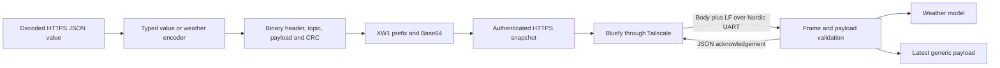

# XWR binary relay protocol

XWR version 1 carries a topic, sequence and typed payload in a binary frame. [binary_protocol.py](binary_protocol.py) implements the Python encoder/parser, and [binary_protocol.cpp](../project/src/binary_protocol.cpp) implements the firmware parser declared in [binary_protocol.h](../project/include/binary_protocol.h). [data_sources.py](data_sources.py) converts source JSON values or a normalized forecast into XWR. The watch validates a complete frame before applying weather or replacing its generic cache.

The text representation contains `XW1:` followed by Base64 so that the same packet passes through the HTTP snapshot and LF-delimited NUS stream. The project bounds this body at **256 bytes** before LF, permitting at most 189 raw frame bytes. Source JSON reads on the PC have a separate 256 KiB limit. These configured limits do not describe the board's RAM capacity or a Bluetooth hardware limit. XWR sends one bounded frame per update and does not reassemble larger application payloads.



[server.py](browser/server.py) serves the XWR text bodies in an authenticated snapshot. [relay_protocol.js](browser/relay_protocol.js) validates framing, CRC and metadata before [relay_client.js](browser/relay_client.js) forwards each body through NUS and matches the watch's acknowledgement. [phone_protocol.cpp](../project/src/phone_protocol.cpp) performs final payload and sequence validation. The [browser guide](browser/README.md) documents setup and foreground operation.

Before sending application packets, [relay_client.js](browser/relay_client.js) prepares each acquired GATT session because iOS can retain the physical BLE connection after the webpage disconnects. It subscribes to replies, writes NUL followed by LF to discard unfinished input, and sends a newline-terminated JSON object with `v: 1`, `type: "probe"` and a fresh random unsigned 32-bit `seq`. The existing unknown-type path in [phone_protocol.cpp](../project/src/phone_protocol.cpp) returns an ACK with `for: "unknown"`, that sequence, `ok: false` and `status: "invalid_message"` without changing model data or sequence history. This intentional rejection confirms a clean stream boundary; it does not add a supported application message type. The browser discards bounded earlier replies during this preparation and starts ordinary strict parsing and delivery only after the matching probe ACK.

## Text wrapper and size

The body is ASCII `XW1:` followed immediately by canonical padded standard Base64. Its alphabet uses `+` and `/`, with `=` only where padding is required. Unused padding bits must be zero. The wire body contains no newline, whitespace or trailing data. The parser rejects URL-safe substitutions and alternate encodings of the same bytes.

For a raw frame of `n` bytes, the text wrapper uses `4 + 4 × ceil(n / 3)` bytes. The 256-byte body limit therefore permits at most 189 raw bytes. A frame's fixed header and CRC consume 15 bytes, so a topic of `t` bytes leaves at most `174 - t` bytes for the encoded payload. Payload tags and length prefixes count toward that space. A one-character topic can carry an opaque value containing at most 170 bytes after its three-byte tag and length prefix.

The weather frame contains an 11-byte header, seven topic bytes, 118 payload bytes and a four-byte CRC. Its 140 raw bytes become 192 ASCII bytes. Generic values have different overheads; binary encoding does not guarantee a smaller result for every short scalar or object.

## Binary frame

All multibyte header and checksum fields use little-endian byte order. Header offsets below start at the first raw frame byte, after Base64 decoding. Python represents the 11-byte header with `struct.Struct("<2sBBIBH")`.

| Offset | Width | Field | Interpretation |
| --- | --- | --- | --- |
| `0` | `2` bytes | `magic` | The bytes are ASCII `XW`, or hexadecimal `58 57`. |
| `2` | `1` byte | `version` | The value is `1`. Other versions are rejected. |
| `3` | `1` byte | `codec` | The value is `0` for a typed generic payload or `1` for packed weather. |
| `4` | `4` bytes | `sequence` | The field is an unsigned 32-bit integer. The PC server uses Unix UTC seconds; a direct NUS client may use another increasing sequence. |
| `8` | `1` byte | `topic_length` | The field gives the topic's ASCII byte length, from 1 through 32. |
| `9` | `2` bytes | `payload_length` | The field gives the encoded payload's byte length. The complete frame must still fit within 189 bytes. |
| `11` | `topic_length` bytes | `topic` | The topic begins with an ASCII letter or digit and then permits ASCII letters, digits and `._/-`. |
| `11 + topic_length` | `payload_length` bytes | `payload` | The selected codec determines the payload's representation. |
| `11 + topic_length + payload_length` | `4` bytes | `crc32` | The checksum covers every preceding raw frame byte and excludes itself. |

The topic expression is `[A-Za-z0-9][A-Za-z0-9._/-]{0,31}` with an exact end-of-input match. Topics are case-sensitive. The exact topic `weather` requires codec `1`; every other topic requires codec `0`. There is no terminator after the topic or payload. The declared lengths must consume exactly the complete frame before its CRC.

The checksum uses CRC-32/ISO-HDLC with width 32, normal polynomial `0x04C11DB7`, reflected implementation polynomial `0xEDB88320`, initial value `0xFFFFFFFF`, reflected input and output, and final XOR `0xFFFFFFFF`. Its check value for ASCII `123456789` is `0xCBF43926`. Python computes the stored numeric value with `zlib.crc32(frame_without_crc)` and packs it as `<I`. CRC detects accidental corruption; it does not authenticate a publisher or encrypt a message.

## Typed generic payload

Codec `0` contains exactly one typed value. Every value starts with one tag byte. Arrays and objects contain recursively encoded values without alignment or padding. Multibyte integers, floating-point bit patterns and lengths use little-endian order.

| Tag | Value | Encoding after the tag |
| --- | --- | --- |
| `0` | The value is null. | No bytes follow for this value. |
| `1` | The value is false. | No bytes follow for this value. |
| `2` | The value is true. | No bytes follow for this value. |
| `3` | The value is a signed integer. | Eight bytes encode a two's-complement signed 64-bit integer. |
| `4` | The value is a real number. | Eight bytes encode a finite IEEE-754 binary64 value. |
| `5` | The value is text. | A two-byte unsigned length precedes that many UTF-8 bytes. |
| `6` | The value is an array. | A one-byte element count precedes that many complete typed values. |
| `7` | The value is an object. | A one-byte entry count precedes each key and typed value in sequence. Each key has a one-byte UTF-8 byte length followed by its bytes. |
| `8` | The value is opaque bytes. | A two-byte unsigned length precedes that many uninterpreted bytes. |

Integers range from `-9223372036854775808` through `9223372036854775807`. Boolean tags remain distinct from integer values. Floating-point values preserve binary64 bits, including negative zero; infinity and NaN are invalid. Text uses strict UTF-8 and rejects overlong encodings, isolated surrogate values and code points beyond `U+10FFFF`. Empty text, empty keys and embedded NUL are permitted. Readers must use explicit lengths rather than treating these fields as NUL-terminated strings.

Objects contain at most 32 entries, and arrays declare at most 255 elements. The 189-byte frame limit normally imposes a smaller practical count. A payload can nest at most eight array or object containers, counting a root container as the first. Object keys must be unique after UTF-8 decoding; the parser does not normalize Unicode or impose key sorting. Unknown tags, incomplete values and trailing payload bytes fail validation. The encoder preserves array order and object insertion order.

Opaque bytes require an encoder caller to provide bytes explicitly. An HTTPS JSON source supplies JSON values and does not acquire a byte-string type from a particular key name. Generic binary payloads remain encoded in one model cache with an explicit binary encoding marker. Another accepted unknown topic replaces that cache; the cache does not create an application or interpret a domain-specific schema.

## Packed weather payload

Codec `1` retains the existing 118-byte weather representation directly. It removes the inner Base64 string and JSON `packed` wrapper from the binary frame; only the outer text wrapper uses Base64. `binary_protocol.cpp` checks the reserved topic and payload size, [packed_weather.cpp](../project/src/packed_weather.cpp) expands the payload, and `readRelayWeather` in [phone_protocol.cpp](../project/src/phone_protocol.cpp) validates the decoded forecast before changing the model.

The 29-byte weather header uses Python format `<BIhIhIIII`. Its UTC fields are unsigned 32-bit seconds. Its offsets are signed 16-bit minutes. The following offsets are relative to the weather payload, not the enclosing XWR frame.

| Offset | Width | Field | Interpretation |
| --- | --- | --- | --- |
| `0` | `1` byte | `version` | The packed weather version is `1`. |
| `1` | `4` bytes | `generatedAt` | The field records the actual fetch time in UTC. |
| `5` | `2` bytes | `offsetMinutes` | The field gives the supplied local offset before a transition. |
| `7` | `4` bytes | `nextTransitionUtc` | The field gives the next UTC transition, or zero when none is supplied. |
| `11` | `2` bytes | `nextOffsetMinutes` | The field gives the local offset after that transition. |
| `13` | `4` bytes | `observedAt` | The field records the current-condition observation time in UTC. |
| `17` | `4` bytes | `validUntil` | The field records the current-condition validity deadline in UTC. |
| `21` | `4` bytes | `firstHourlyUtc` | The field starts 24 consecutive hourly rows, spaced 3,600 seconds apart. |
| `25` | `4` bytes | `firstDailyUtc` | The field starts seven consecutive local-day summaries. |

The remaining 89 bytes hold an LSB-first bitstream. Its first 468 bits encode 39 signed 12-bit temperatures in Celsius tenths: the current temperature, 24 hourly temperatures and seven minimum/maximum pairs. Its next 224 bits encode 32 unsigned 7-bit WMO codes in current, hourly and daily order. Seven two-bit daily durations follow. Values `0`, `1` and `2` mean 23, 24 and 25 hours, while `3` is invalid. The final six padding bits must be zero.

`pack_weather` in [data_sources.py](data_sources.py) requires exact temperature tenths and whole-minute offsets rather than rounding additional precision away. It preserves the daily modal-icon rule implemented by [upload_weather.py](../project/tools/upload_weather.py) and does not replace it with a maximum-severity code. `packed_weather.cpp` checks version, durations, padding and timestamp arithmetic before `readRelayWeather` in `phone_protocol.cpp` checks temperatures, supported codes, sorted coverage, local-day boundaries and freshness. Neither loading a binary snapshot nor applying its timezone metadata writes the RTC.

## Python encoder and parser

The dependency-free [binary_protocol.py](binary_protocol.py) exposes the following APIs. Its `ValueCodecError` exception reports validation failures without including the input payload. These codec APIs validate representation; [data_sources.py](data_sources.py) validates source values, supported UTC ranges and normalized weather coverage.

| API | Behavior |
| --- | --- |
| `encode_frame(topic, sequence, payload, codec=0)` | This function returns one raw frame as Python `bytes`. |
| `decode_frame(raw)` | This function validates raw `bytes` and returns a dictionary containing `topic`, `sequence`, `codec` and `payload`. |
| `encode_text(topic, sequence, payload, codec=0)` | This function returns the complete `XW1:` text body as ASCII `bytes`. |
| `decode_text(body)` | This function accepts ASCII `bytes` or a Python string and returns the same decoded fields as `decode_frame`. |

Generic values decode to Python `None`, `bool`, `int`, `float`, `str`, `list`, `dict` and `bytes` according to their tags. Packed weather decodes to its 118 raw bytes; `binary_protocol.py` does not expand weather into forecast rows. `data_sources.py` validates packed weather before publication, while `packed_weather.cpp` and `phone_protocol.cpp` expand and validate received weather on the watch. The wire codec accepts the full unsigned 32-bit sequence range, whereas `data_sources.py` restricts server sequences to supported UTC dates. The server and browser check snapshot age; the firmware applies additional freshness checks to weather when RTC time is trusted.

The following example runs in a Python interpreter started at the workspace root. It builds and parses a generic value locally without accessing a source or sending data to the watch. The example's `soccer` topic demonstrates transport only; no soccer application is implemented.

```python
# load the workspace codec without installing packages.
import sys
import time
sys.dont_write_bytecode = True
sys.path.insert(0, "relay")
from binary_protocol import encode_text, decode_text

# encode one generic update with fresh UTC sequencing.
body = encode_text("soccer", int(time.time()), {"home": 2, "away": 1})
print(body.decode("ascii"))

# inspect the parsed fields without publishing the body.
message = decode_text(body)
print(message["topic"], message["sequence"], message["payload"])
```

The standalone parser in `relay/binary_protocol.py` reads one text body from a file or standard input. Run the following command from the workspace root, replacing `message.txt` with a file containing one complete body. Use `python` instead of `python3` when that command names the selected Windows interpreter.

```sh
python3 -B relay/binary_protocol.py message.txt
```

For raw binary input, add `--raw` and supply the binary file. Omitting the filename or using `-` reads standard input. Text input may end with one LF or CRLF in this command-line tool; the strict codec APIs do not accept that line ending as part of a text body. The command prints diagnostic JSON, rendering bytes as `{"$bytes_hex":"..."}`. This display representation does not define another wire format, and a JSON object with that key remains an ordinary object when passed to the encoder.

## Interoperability vector

The generic topic `notes`, sequence `1` and payload `{"count":2,"ok":true}` produce the following 41-byte raw frame. Its encoded payload occupies 21 bytes, and its trailing bytes `87 cc 30 d2` store CRC32 value `0xD230CC87` in little-endian order.

```text
58570100010000000515006e6f746573070205636f756e74030200000000000000026f6b0287cc30d2
```

The corresponding text body occupies 60 ASCII bytes.

```text
XW1:WFcBAAEAAAAFFQBub3RlcwcCBWNvdW50AwIAAAAAAAAAAm9rAofMMNI=
```

This sequence supports repeatable local parser checks and a fresh NUS session. It is not a current timestamp, so a server snapshot containing it fails browser freshness checks. Live server packets use current computer UTC and increasing sequences. The following commands parse data locally without sending it to the watch.

On Windows PowerShell, select PlatformIO's Python and pipe the vector to the parser.

```powershell
$protocolPython = Join-Path $env:USERPROFILE '.platformio\penv\Scripts\python.exe'
'XW1:WFcBAAEAAAAFFQBub3RlcwcCBWNvdW50AwIAAAAAAAAAAm9rAofMMNI=' | & $protocolPython -B relay/binary_protocol.py
```

On macOS or Linux, use the selected Python 3.9-or-newer interpreter from the workspace root.

```bash
printf '%s\n' 'XW1:WFcBAAEAAAAFFQBub3RlcwcCBWNvdW50AwIAAAAAAAAAAm9rAofMMNI=' | python3 -B relay/binary_protocol.py
```

The decoded result contains topic `notes`, sequence `1`, codec `0` and the original map with integer `count` equal to `2` and boolean `ok` equal to `true`.

## Firmware parser and storage

[binary_protocol.h](../project/include/binary_protocol.h) declares raw-frame, text-wrapper and typed-value parsers implemented in [binary_protocol.cpp](../project/src/binary_protocol.cpp). They use bounded recursive validation and borrowed views without heap allocation. A caller must keep each backing buffer alive and unmodified while any envelope, value or iterator refers to it. The text parser writes decoded frame bytes into caller-owned storage.

| API | Behavior |
| --- | --- |
| `watch::parseBinaryFrame(data, length, envelope)` | This function validates a raw frame of at most 189 bytes and exposes its topic, sequence, codec and borrowed payload. |
| `watch::parseBinaryText(text, length, storage, capacity, envelope)` | This function validates an `XW1:` body of at most 256 bytes, decodes into the supplied buffer and validates its frame. |
| `watch::parseBinaryValue(data, length, value)` | This function validates exactly one typed generic value with a separate 189-byte input bound. |
| `watch::BinaryValue` | This view exposes `type()`, `boolean()`, `integer()`, `real()`, `bytes()`, `count()`, `iterator()`, `encoded()` and `encodedBytes()`. Scalar accessors require the matching tag. |
| `watch::BinaryIterator::next(...)` | This method traverses array children or object entries in wire order and optionally exposes each borrowed UTF-8 key and length. |
| `watch::binaryCrc32(data, length)` | This function computes the protocol checksum for a supplied byte range. |

The `bytes()` accessor handles either text or opaque bytes; `type()` distinguishes them. The parser clears the returned envelope or value view on failure. It does not promise to erase partially decoded scratch storage. Duplicate-key validation rescans prior bounded entries rather than allocating per-container key tables; its work remains bounded by 32 keys, eight container levels and the 189-byte frame cap.

Representation parsing does not apply data or enforce publication age. In [phone_protocol.cpp](../project/src/phone_protocol.cpp), `ProtocolSession::apply(...)` dispatches an XWR text body or ASCII JSON into the application's shared model and ordering rules, while `ProtocolSession::applyBinary(...)` accepts a raw frame from a caller that already preserves message boundaries. Neither function adds a raw-byte GATT service. [packed_weather.cpp](../project/src/packed_weather.cpp) uses a bounded ArduinoJson allocation to expand weather for `readRelayWeather` in `phone_protocol.cpp`; allocation-free parsing applies to the binary frame and generic value views.

Generic consumers must inspect `WatchState::genericEncoding` and use `genericPayloadBytes` as the length, as declared in [watch_model.h](../project/include/watch_model.h). `PayloadEncoding::Binary` stores the typed payload bytes, without the outer XWR header or CRC, while `PayloadEncoding::Json` stores an ASCII JSON value. Binary text and opaque values may contain NUL, so string-length functions cannot measure that cache. Weather uses separate model storage and does not replace its encoding marker.

Application processing stages data and topic history before committing. A repeated accepted sequence reports `duplicate` and retains the existing value. An older sequence fails. Eight topic histories remain available during a physical BLE connection; a ninth distinct topic fails instead of silently evicting history. Invalid input changes neither application data nor accepted sequence history. A physical reconnect resets that history, whereas reconnecting a webpage on an iPhone link retained by iOS does not.

Generic NUS sequences express ordering and do not require a trusted RTC or publication UTC. The PC server uses UTC sequences and bounds batch age to 900 seconds with at most 300 seconds of future skew. [relay_protocol.js](browser/relay_protocol.js) checks that metadata against server and phone time. Weather additionally carries its fetch and observation times: when the RTC is trusted, `readRelayWeather` rejects a fetch more than 900 seconds old, more than 300 seconds ahead, or past the observation deadline. Generic data does not inherit weather's RTC checks.

## Bluetooth framing and replies

[main.cpp](../project/src/main.cpp) receives NUS input and passes complete frames to [phone_protocol.cpp](../project/src/phone_protocol.cpp). The service UUID is `6E400001-B5A3-F393-E0A9-E50E24DCCA9E`. RX writes use `6E400002-B5A3-F393-E0A9-E50E24DCCA9E`, and TX replies use `6E400003-B5A3-F393-E0A9-E50E24DCCA9E`.

Subscribe to TX before sending a packet. Append LF to its text body and use sequential writes with response containing at most 20 bytes each. A frame times out after 15 seconds without another byte. Invalid bytes or overflow discard input until LF; the browser's NUL/LF preparation therefore clears an unfinished frame before sending its probe. The text codec itself does not include the line terminator.

The firmware also accepts ASCII JSON frames for manual clients, with an 8,192-byte bound before LF and a 1,024-byte generic payload limit. [strict_json.cpp](../project/src/strict_json.cpp) rejects duplicate keys, invalid escapes, unpaired surrogates, nonfinite values and trailing content. NUS acknowledgements and polls use JSON regardless of the incoming data representation. The separate manual service remains documented in [LIGHTBLUE.md](../project/LIGHTBLUE.md).

The watch returns an application acknowledgement after processing a complete packet. The following response confirms a new value for topic `notes` with sequence `1`.

```json
{"v":1,"type":"ack","for":"data","seq":1,"ok":true,"status":"applied","topic":"notes"}
```

Accept only `applied` or `duplicate` with `ok: true` and the exact expected topic and sequence. A successful GATT write response confirms an individual transport write, not application acceptance. TX uses BLE characteristic notifications, and an acknowledgement can span several such fragments. The browser reconstructs LF-terminated lines with a 1,024-byte limit and allows at most 15 seconds for the matching acknowledgement.

[relay_schedule.h](../project/include/relay_schedule.h) requests data after TX subscription and every 900 connected seconds afterward. The poll shares the TX stream with acknowledgements.

```json
{"v":1,"type":"poll","interval":900}
```

The browser responds by checking the current authenticated snapshot. The request does not force another source fetch or alter the PC server's independent 900-second schedule. [The relay guide](README.md) explains model updates and USB status; [the browser guide](browser/README.md) records the observed device delivery and reconnection behavior.
