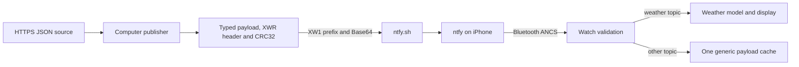

# Data relay

The relay brings HTTPS data to the watch through a computer, the existing ntfy iPhone app and Bluetooth. [publisher.py](publisher/publisher.py) fetches and validates source JSON, converts it to the project's XWR binary protocol through [binary_protocol.py](publisher/binary_protocol.py), and sends its Base64 text wrapper through ntfy. The paired iPhone exposes that body through Apple Notification Center Service (ANCS), received by [notification_relay.cpp](../project/src/notification_relay.cpp). Weather provides the first display adapter. Other topics retain a typed value in `WatchState`, declared in [watch_model.h](../project/include/watch_model.h), for a future application handler without creating a watch screen.

The computer and iPhone need internet access. Only the iPhone and watch need Bluetooth range; the computer can remain elsewhere. The publisher attempts an update every 900 seconds while running. Delivery can continue while the iPhone is locked, but unlocking does not trigger another fetch and push arrival times are not guaranteed. The watch keeps its hardware RTC and uploaded weather fallback when the relay is unavailable.



## Connect the phone and watch

Build and upload through the [firmware guide](../project/README.md), then confirm that USB provisioning has set the RTC. Notification acceptance requires a trusted clock because the receiver compares publication time with current UTC. Bluetooth messages cannot set the clock.

Install the [ntfy iPhone app](https://apps.apple.com/us/app/ntfy/id1625396347) and allow notifications. Prepare or recover the existing random channel using the [publisher guide](publisher/README.md#prepare-the-subscription), select `https://ntfy.sh` as the server, and subscribe to that exact channel. The channel identifies the ntfy subscription; the protocol topic identifies data such as `weather` or `notes`. Updating from legacy JSON to XWR keeps that subscription and the notification title `XIAO Relay v1`.

Open iPhone Settings, select Notifications, then ntfy. Enable Notification Center and Lock Screen, set Show Previews to Always, and remove any Focus or Scheduled Summary delay during setup. Notification Center is a separate option from Lock Screen. This configuration passed locked-phone delivery on the assembled watch. Showing ntfy previews while locked also exposes those notification contents on the phone.

Disconnect any diagnostic BLE client before pairing. In iPhone Bluetooth Settings, select `XIAO Watch`, accept pairing and allow notification sharing. Enable Share System Notifications on the device information page if shown. If Settings does not list the watch, connect once through LightBlue to initiate pairing, then disconnect LightBlue and return to Settings. The firmware supports one peripheral connection at a time. After an upload, reconnect the watch; if a stale bond prevents connection, forget the device on the phone and pair it again.

Leave ntfy in the background while testing and keep the watch within range. Send one weather message using the publisher guide, leave the notification untouched, and check the watch's Weather app and USB acceptance counters. Repeat with the phone locked and a new message. An in-app message or a successful HTTP request alone does not establish ANCS delivery.

## Run and inspect delivery

The [publisher guide](publisher/README.md) provides Windows, macOS and Linux commands for a one-shot fetch, an explicit send and a foreground loop in [publisher.py](publisher/publisher.py). [schedule_pc.ps1](publisher/schedule_pc.ps1) manages the Windows task, whose action calls [run_pc.ps1](publisher/run_pc.ps1). The existing Windows deployment has an enabled 15-minute task; a new checkout does not install a task through a firmware build. Run either the task or foreground loop for a given source to avoid duplicate traffic.

Open a PlatformIO serial monitor at 115200 baud and send `?` to request USB status from [main.cpp](../project/src/main.cpp). Close that monitor before uploading or running [sync_rtc.py](../project/tools/sync_rtc.py). The `ANCS` line reports encryption, subscriptions, events and application results. The `RELAY` line identifies the latest accepted topic and sequence, while `WEATHER fetched_utc` identifies the active weather's fetch time.

| Diagnostic | Interpretation |
| --- | --- |
| `secured=1` and `subscribed=1` | The encrypted connection exists and the phone acknowledged the ANCS subscriptions. These fields do not establish application acceptance. |
| `applied` and `result=applied` | The application accepted a new envelope. Its topic and sequence appear on the `RELAY` line. |
| `result=duplicate` | The topic sequence was accepted previously, so the receiver retains its existing data. |
| `rejected` | The application rejected a body after checking its representation, schema, sequence or freshness. |
| `reported_length`, `body_length` and `body_hash` | Compare the length and FNV-1a fingerprint with the publisher log to detect missing or altered bytes. The fingerprint provides diagnostics, not authentication. |
| `binary_v=1` | The installed firmware supports XWR v1. This capability flag does not identify the format of the most recent accepted message. |
| `generic_bytes` and `generic_format` | These fields describe the separate generic cache. A weather update can leave `generic_bytes=0` and `generic_format=json` because it uses the weather model instead. |
| `app_filtered` and `title_filtered` | The receiver excluded a notification whose application identifier or title did not match. |
| `embedded=0`, `hours=24` and `days=7` | The active weather is no longer the embedded fallback and retains both forecast ranges. Match its fetch time with the publication under test. |

If ntfy receives a notification but the watch does not apply it, check Notification Center, Always previews, Share System Notifications, the BLE connection and trusted RTC time. Compare the publisher's sequence and fingerprint with USB status. A binary weather body has 192 characters and begins with `XW1:`; it no longer displays readable weather JSON in Notification Center. [binary_protocol.py](publisher/binary_protocol.py) can inspect a saved body without publishing it, using the [local parser commands](publisher/README.md#select-an-interpreter-and-check-a-source). A shortened notification cannot update the model. Source validation failures or watch-side rejection leave the previous snapshot in place, and [watch_model.cpp](../project/src/watch_model.cpp) continues to apply its freshness and forecast-coverage rules. An uncertain HTTP result can follow server acceptance, so only watch metadata establishes whether that attempt reached the model.

Two complete 240-byte JSON weather messages passed through a locked iPhone to the assembled watch on October 18, 2026. One originated from a manually started Windows Task Scheduler action. Device reports matched their sequences and fingerprints and retained 24 hourly rows and seven daily rows; the forecast screens were also checked on the watch.

On October 19, 2026, a 192-byte XWR weather notification passed through the iPhone with sequence and fetch timestamp `1792456927`. The publisher and watch reported the same fingerprint, `F0A302BE`. USB reported one received and accepted update, zero ANCS errors, drops or rejections, and a live snapshot containing 24 hourly and seven daily records. The RTC remained trusted and advanced to `1792456932`. This binary transfer did not include a separate screen or phone lock-state confirmation. Repeated natural intervals and long-duration reconnection behavior require separate observation.

## Notification processing

[notification_relay.cpp](../project/src/notification_relay.cpp) retrieves an application's identifier before requesting its title or message. It accepts `io.heckel.ntfy` with the exact title `XIAO Relay v1`, allowing only paired iOS directional markers around that title. It does not request other applications' message bodies or display arbitrary notifications. Its worker discovers ANCS, tracks Service Changed indications and uses [notification_frame.cpp](../project/src/notification_frame.cpp) to assemble attribute fragments before passing a complete body to the watch task in [main.cpp](../project/src/main.cpp). Apple documents authorization and dynamic service availability in the [ANCS specification](https://developer.apple.com/library/archive/documentation/CoreBluetooth/Reference/AppleNotificationCenterServiceSpecification/Specification/Specification.html).

`publisher.py` calls [binary_protocol.py](publisher/binary_protocol.py) to emit `XW1:` followed by canonical padded Base64 containing an XWR frame. [binary_protocol.cpp](../project/src/binary_protocol.cpp) validates that representation, [notification_protocol.cpp](../project/src/notification_protocol.cpp) checks notification freshness, and [phone_protocol.cpp](../project/src/phone_protocol.cpp) validates application data and ordering. The binary header carries a version, codec, unsigned 32-bit sequence, topic length and payload length. CRC32 covers the header, topic and payload against accidental corruption. Notification bodies have no LF terminator. The [protocol specification](PROTOCOL.md) documents every field, typed value, checksum parameter and parser API, including a reproducible [interoperability vector](PROTOCOL.md#interoperability-vector).

| Contract | Implemented behavior |
| --- | --- |
| Frame and topic | Version `1` supports typed generic values and packed weather. Topics contain 1–32 ASCII characters, begin with an alphanumeric character and use only alphanumeric characters or `._/-` afterward. |
| Freshness | `seq` records publication UTC. The notification receiver requires a trusted RTC and permits at most 15 minutes of age or five minutes ahead of that clock. |
| Ordering | Sequences increase per topic. Duplicate sequences retain previous values; older sequences fail. Eight topic histories survive ANCS reconnects until watch reboot. |
| Generic storage | The model retains one unknown-topic payload, topic, sequence and encoding marker in RAM. A newer unknown topic replaces that cache. Weather has separate storage. |
| Notification size | The complete ASCII body is at most 256 bytes, permitting a raw binary frame of at most 189 bytes. The general notification buffer remains bounded at 3,000 bytes for compatibility, but it does not enlarge the tested phone path. |
| Binary validation | The parser rejects invalid versions, lengths, CRCs, tags, UTF-8, duplicate keys, nonfinite numbers, noncanonical Base64 and trailing data. It limits nesting to eight container levels and objects to 32 keys. |
| Rejection and restart | Failed validation leaves state and topic history unchanged. Reboot clears RAM data and sequences, then restores the dated weather embedded during upload. |

The 256-byte ceiling reflects the tested phone route, not a universal Apple ANCS limit. It means bytes rather than kilobytes. The separate 256 KiB limit applies to source JSON reads on the computer. Topic length, value tags and lengths consume part of each binary frame, and the publisher rejects oversized values instead of shortening or splitting them. Public ntfy topics allow anyone who knows a channel name to subscribe or publish, so random names and CRCs do not provide end-to-end encryption or publisher authentication. This route carries nonsensitive data such as public weather. [ntfy publishing documentation](https://docs.ntfy.sh/publish/)

Use `publisher.py --wire-format json` only when an older receiver still requires the previous envelope. The updated firmware accepts that envelope alongside XWR, with the same freshness and topic-history checks. [strict_json.cpp](../project/src/strict_json.cpp) and `phone_protocol.cpp` continue to reject duplicate keys, invalid escapes, unpaired surrogates, nonfinite values and trailing content. The default publisher format is binary; switching formats does not change the notification title, phone subscription or RTC ownership.

## Weather adapter

The reserved `weather` topic carries current conditions for the clock-face complication, 24 consecutive hourly forecasts and seven local-day summaries. [upload_weather.py](../project/tools/upload_weather.py) selects ZIP 10018 at latitude `40.7547`, longitude `-73.9925`, timezone `America/New_York`, and Celsius. Daily rows cover today and the next six local dates. Its `normalize` function counts hourly icon groups and selects the most frequent group, resolving a tie by its first occurrence that day. Each row retains that icon and the day's minimum and maximum temperature.

[publisher.py](publisher/publisher.py) imports `upload_weather.py` and uses `pack_weather` to place its complete 118-byte packed forecast in a codec-1 XWR frame. The complete notification occupies 192 ASCII bytes, compared with the earlier 240-byte JSON envelope with a ten-digit sequence. This saves 48 bytes, or 20 percent, while retaining the same forecast fields. [packed_weather.cpp](../project/src/packed_weather.cpp) expands the packed representation into a bounded ArduinoJson object before `readRelayWeather` in [phone_protocol.cpp](../project/src/phone_protocol.cpp) validates it. [binary_protocol.cpp](../project/src/binary_protocol.cpp) parses frames and generic values without heap allocation; weather expansion retains the existing bounded allocation path. The normalized JSON form remains available through the diagnostic Nordic UART Service (NUS).

| Normalized field | Meaning |
| --- | --- |
| `generatedAt` | This value records the actual fetch time in Unix UTC seconds. |
| `offsetSeconds`, `nextTransitionUtc` and `nextOffsetSeconds` | These values describe the local display offset and next transition while the RTC remains in UTC. A zero transition indicates no supplied transition. |
| `observedAt` and `validUntil` | These values identify the provider's current-condition time and freshness deadline. The adapter permits a one-hour observation lifetime. |
| `tempC` and `code` | These values contain a finite Celsius temperature and a supported WMO condition code. |
| `hourly` | This array contains exactly 24 rows with `utc`, `tempC` and `code`, spaced 3,600 seconds apart. |
| `daily` | This array contains exactly seven rows with `utc`, `nextUtc`, `minTempC`, `maxTempC` and `code`, preserving 23-, 24- or 25-hour local days. |

The [packed weather layout](PROTOCOL.md#packed-weather-payload) records the 29-byte header and 89-byte bitstream. Packing requires exact Celsius tenths and whole-minute UTC offsets; it rejects additional precision rather than rounding it away. Decoding rejects wrong versions, reserved daily durations, nonzero padding and timestamp overflow. The shared validator checks every row and time boundary before replacing the snapshot. With trusted time, a fetch more than 15 minutes old, more than five minutes ahead, or past the current-condition deadline fails.

`phone_protocol.cpp` replaces the in-memory forecast and timezone metadata without setting the RTC. [watch_ui.cpp](../project/src/watch_ui.cpp) renders `Updated MM/DD/YY HH:MM:SS` from fetch time and its local offset above both Weather tabs. The header omits current conditions and snapshot labels. [watch_model.cpp](../project/src/watch_model.cpp) selects current conditions while valid and available hourly predictions afterward for the face; data outside stored coverage remains unavailable.

## Diagnostic Bluetooth transport

[main.cpp](../project/src/main.cpp) exposes NUS for manual diagnostics, settings and alternate senders, with framing and application parsing in [phone_protocol.cpp](../project/src/phone_protocol.cpp). It accepts XWR text bodies and legacy JSON frames. Its service UUID is `6E400001-B5A3-F393-E0A9-E50E24DCCA9E`; RX writes use `6E400002-B5A3-F393-E0A9-E50E24DCCA9E`, and TX notifications use `6E400003-B5A3-F393-E0A9-E50E24DCCA9E`. The [LightBlue guide](../project/LIGHTBLUE.md) covers manual operation.

Subscribe to TX, send paced writes with response in chunks of at most 20 bytes, and terminate each XWR text body or ASCII JSON object with LF. An XWR body retains its 256-byte bound before LF. A legacy JSON frame may contain at most 8,192 bytes before LF and uses escapes for Unicode text. Its generic payload can occupy up to 1,024 bytes, independently of the smaller binary frame. An incomplete NUS frame times out after 15 seconds without another byte.

NUS uses an unsigned 32-bit sequence that increases per topic within a connection; it does not require publication UTC. Reconnect before sequence wrap. Its eight-topic history resets with a BLE session, whereas ANCS retains history across reconnects. A sender must reassemble the application acknowledgement, since a GATT write response alone does not prove application acceptance.

```json
{"v":1,"type":"ack","for":"data","seq":1,"ok":true,"status":"applied","topic":"notes"}
```

Accept `applied` or `duplicate` only when topic and sequence match the expected message. ACKs can span several notifications. The same output stream can carry a poll when TX becomes subscribed and every 900 connected seconds afterward.

```json
{"v":1,"type":"poll","interval":900}
```

[relay_schedule.h](../project/include/relay_schedule.h) schedules polls for an alternate NUS sender; they do not trigger `publisher.py`. [manual_protocol.cpp](../project/src/manual_protocol.cpp) handles the separate manual weather commands, which can replace the snapshot without preserving daily rows, so the `data`/`weather` envelope provides the complete relay forecast. Soccer remains a planned source and UI feature rather than an implemented application.
