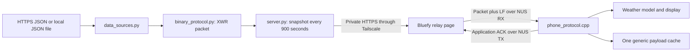

# Data relay

The relay carries data from a PC to the watch through Tailscale HTTPS, the Bluefy iPhone browser and Bluetooth. [data_sources.py](data_sources.py) fetches and validates source values, and [binary_protocol.py](binary_protocol.py) encodes them in the project's XWR format. [server.py](browser/server.py) publishes an authenticated snapshot. [relay_client.js](browser/relay_client.js) forwards its packets through the watch's Nordic UART Service (NUS) and waits for application acknowledgements.

Weather provides the first display adapter. Other topics reach the generic cache declared in [watch_model.h](../project/include/watch_model.h), where a future application can interpret their data. A generic topic does not create a screen. The PC can remain elsewhere while the iPhone has internet access and stays within Bluetooth range of the watch.

## Operate the relay

Follow the [browser guide](browser/README.md) to start the PC server, enable Tailscale Serve and connect Bluefy to `XIAO Watch`. That guide provides Windows, macOS and Linux commands, token setup, reconnection steps and restart behavior. The software uses the Python standard library and existing iPhone applications; it does not require a custom iPhone application. Tailscale's personal plan and Bluefy provide the configured access path without a paid server.

Keep the PC awake and online with [server.py](browser/server.py) running. Keep the relay page visible in Bluefy for delivery. The PC attempts a source refresh every 900 seconds, while the visible page checks the latest snapshot every 30 seconds and responds to watch refresh requests. Returning to the page requests current data when the Bluetooth link remains available. Unlocking the iPhone while another application is open does not run the page, and background delivery is not guaranteed.

After a PC restart, start the server again. On Windows, [manage_pc.ps1](browser/manage_pc.ps1) provides `Start`, `Status` and `Stop`; it does not install an automatic startup task. The Tailscale Serve mapping persists when configured with `--bg`, but that mapping does not start Python. Keep the existing token in `relay/browser/.local/access_token.txt` and enter it again if the Bluefy page reloads.

Select Reconnect watch after a normal page disconnection. [relay_client.js](browser/relay_client.js) retains the authorized Bluetooth device and restores it after reload when Bluefy provides saved-device access. An iPhone can keep its native BLE connection after the page disconnects, leaving the watch absent from a new discovery scan. Reusing the saved device avoids requiring removal of the iPhone pairing. Choose watch opens an explicit picker when selecting a different device or when no saved access exists.

## Validate delivery

Build and upload using the [firmware guide](../project/README.md). The upload process sets the external RTC and embeds a fallback forecast. Relay updates replace weather and timezone metadata without setting the RTC. When the RTC is trusted, the watch rejects weather fetched more than 900 seconds earlier, more than 300 seconds ahead, or beyond the current observation's validity deadline.

The Bluefy page reports Applied when the matching application acknowledgement confirms a new update. Already accepted indicates a matching duplicate acknowledgement. A successful HTTPS response or individual GATT write does not establish that the watch accepted a packet. Check both Weather tabs and the updated time on the watch after the page reports acceptance.

Open a serial monitor at 115200 baud and send `?` to request status from [main.cpp](../project/src/main.cpp). Close the monitor before an upload or [sync_rtc.py](../project/tools/sync_rtc.py) uses the port.

| Status field | Interpretation |
| --- | --- |
| `BLE connected=1` | The watch has a physical BLE connection, which can remain active after a browser session ends. |
| `RTC trusted=1` and `time_valid=1` | The RTC provides trusted time for the display and weather freshness checks. |
| `RELAY revision`, `topic` and `seq` | These fields identify the latest applied relay update. A matching duplicate leaves the revision unchanged. |
| `binary_v=1` | The firmware supports XWR v1. This capability flag does not identify the last accepted format. |
| `generic_bytes` and `generic_format` | These fields describe the separate generic cache. Weather uses its own model storage. |
| `WEATHER embedded=0`, `hours=24` and `days=7` | The active forecast has replaced the embedded fallback and contains both forecast ranges. |
| `WEATHER fetched_utc` | This value identifies the fetch time used by the Weather app's updated header. |

A rejected packet leaves application data and accepted sequence history unchanged. The server retains a failed refresh's previous batch without extending its expiry. [watch_model.cpp](../project/src/watch_model.cpp) continues to enforce the stored forecast's coverage after delivery stops. Reboot clears relay data from RAM and restores the forecast embedded during upload.

## Packet and storage contract

[PROTOCOL.md](PROTOCOL.md) specifies the XWR header, typed values, weather packing, CRC32, parser APIs and interoperability vector. Each text body contains `XW1:` followed by canonical padded Base64 and occupies at most 256 bytes before LF. That configured bound permits at most 189 raw frame bytes; it is not the board's RAM capacity or a Bluetooth hardware limit. Source JSON reads on the PC have a separate 256 KiB bound.

| Contract | Implemented behavior |
| --- | --- |
| Topics and batches | The server accepts one to eight unique topics. Topic names contain 1 to 32 ASCII characters, with an alphanumeric first character and only alphanumeric characters or `._/-` afterward. |
| Sequence ordering | The PC uses Unix UTC seconds. The watch requires an increasing unsigned 32-bit sequence per topic within a physical BLE session. |
| Duplicate handling | A repeated accepted sequence preserves data and returns `duplicate`. Older sequences fail. |
| Topic history | The watch retains eight topic histories during the physical BLE connection. Reconnecting only the webpage can preserve that history. |
| Generic storage | One accepted generic topic replaces the preceding generic cache. Weather retains separate storage. |
| Representation checks | The parser rejects malformed lengths, versions, CRCs, UTF-8, duplicate keys, nonfinite numbers, noncanonical Base64 and trailing data. |
| Transport chunks | Bluefy sends sequential writes with response containing at most 20 bytes each. Those writes carry one bounded application packet, rather than enlarging its size limit. |

The HTTP token limits snapshot access, Tailscale restricts reachability to the private network, and HTTPS protects the HTTP exchange. XWR's CRC detects accidental corruption; it provides neither encryption nor sender authentication. The watch's NUS characteristics permit a connected client to exchange data without an application-level credential, so the HTTP token does not authorize Bluetooth writes on the watch.

## Weather adapter

[data_sources.py](data_sources.py) imports the normalization rules in [upload_weather.py](../project/tools/upload_weather.py) to fetch Open-Meteo data for ZIP 10018 at latitude `40.7547`, longitude `-73.9925`, in `America/New_York`. The adapter retains Celsius values, current conditions, 24 upcoming hourly rows and seven local-day summaries starting with today. Each daily row contains the most frequent weather-icon group and minimum and maximum temperatures; a tie selects the first encountered group.

The `pack_weather` function encodes a 118-byte forecast payload. An XWR weather frame occupies 140 raw bytes or 192 ASCII bytes before LF. [packed_weather.cpp](../project/src/packed_weather.cpp) expands that payload before `readRelayWeather` in [phone_protocol.cpp](../project/src/phone_protocol.cpp) checks forecast coverage, weather codes, time boundaries and freshness.

| Normalized field | Meaning |
| --- | --- |
| `generatedAt` | This field records the actual fetch time in Unix UTC seconds. |
| `offsetSeconds`, `nextTransitionUtc` and `nextOffsetSeconds` | These fields describe local display offsets and the next transition while the RTC remains in UTC. |
| `observedAt` and `validUntil` | These fields identify the current-condition observation time and validity deadline, with at most one hour between them. |
| `tempC` and `code` | These fields contain a finite Celsius temperature and supported WMO condition code. |
| `hourly` | This array contains 24 rows with `utc`, `tempC` and `code`, spaced 3,600 seconds apart. |
| `daily` | This array contains seven rows with `utc`, `nextUtc`, `minTempC`, `maxTempC` and `code`, preserving 23-, 24- and 25-hour local days. |

[watch_ui.cpp](../project/src/watch_ui.cpp) displays `Updated MM/DD/YY HH:MM:SS` above both Weather tabs. The face uses current conditions while valid and an available hourly prediction afterward. Data outside the stored forecast's coverage remains unavailable. Soccer remains a planned data adapter and application.

## Manual Bluetooth access

[LIGHTBLUE.md](../project/LIGHTBLUE.md) documents the separate manual service and NUS diagnostics. [phone_protocol.cpp](../project/src/phone_protocol.cpp) also accepts LF-terminated ASCII JSON frames for those clients, including settings and generic data. JSON frames have an 8,192-byte bound before LF and a 1,024-byte generic payload limit; those limits do not enlarge the XWR packet. Manual weather commands can replace the snapshot without preserving daily rows, so the relay's `weather` topic provides the complete forecast.

NUS TX uses Bluetooth characteristic notifications to carry acknowledgements and polls. [relay_schedule.h](../project/include/relay_schedule.h) requests a refresh after TX subscription and every 900 connected seconds afterward. The browser handles these requests by fetching the current server batch; they do not change the server's independent source schedule.
