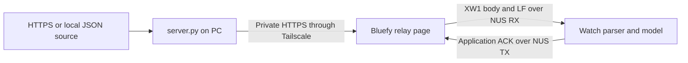

# Browser data relay

The relay carries PC-fetched data to the watch through Tailscale HTTPS and the Bluefy iPhone browser. [server.py](server.py) prepares XWR packets, and [relay_client.js](relay_client.js) forwards them through the watch's Nordic UART Service (NUS). The watch validates each packet and returns an application acknowledgement before the page reports acceptance.

Keep the PC awake and online and the relay page visible in Bluefy for delivery. Returning to the page checks for newer data, but unlocking the iPhone while another application is open does not run it. The phone can reach the PC over cellular data or another Wi-Fi network while remaining within Bluetooth range of the watch. Background delivery and an exact watch update interval are not guaranteed.



## Start the PC server

Run the following commands from the repository root with Python 3.9 or later. [server.py](server.py) uses the Python standard library and imports [data_sources.py](../data_sources.py), [binary_protocol.py](../binary_protocol.py), and [upload_weather.py](../../project/tools/upload_weather.py); no additional Python package installation is required. Keep the PC awake, online, and running the server during delivery.

On Windows, validate one weather fetch in PowerShell before starting the server. The validation command prints only packet counts and encoded sizes. It fetches and validates data without creating an access token or starting a listener.

```powershell
py -3 relay/browser/server.py --check
py -3 relay/browser/server.py
```

On macOS and Linux, use the corresponding Python command from Terminal.

```sh
python3 relay/browser/server.py --check
python3 relay/browser/server.py
```

Normal startup binds to `127.0.0.1:8765`, fetches weather immediately, and attempts another fetch every 900 seconds. The terminal remains occupied until the server stops; press Ctrl+C to stop it. A successful refresh reports `snapshot ready: packets=1`. No operating-system service or scheduled task is installed by this command.

On Windows, [manage_pc.ps1](manage_pc.ps1) can run the same weather server in a hidden process. Run Start once, use Status to inspect the listener, and use Stop to end the managed process. The manager uses an existing PlatformIO Python installation; supply `-PythonPath C:\path\to\python.exe` for another Python 3.9-or-later installation. It does not install a scheduled task or restart Python after signing out or rebooting. Run Start again when needed. Tailscale Serve and the Python process must both be running.

```powershell
powershell.exe -NoProfile -ExecutionPolicy Bypass -File .\relay\browser\manage_pc.ps1 -Action Start
powershell.exe -NoProfile -ExecutionPolicy Bypass -File .\relay\browser\manage_pc.ps1 -Action Status
```

To stop the managed server, run the following command. The manager verifies its recorded process identity before stopping it.

```powershell
powershell.exe -NoProfile -ExecutionPolicy Bypass -File .\relay\browser\manage_pc.ps1 -Action Stop
```

The private `relay/browser/.local/server_process.json` file records the managed process. `relay/browser/.local/server_stdout.log` and `relay/browser/.local/server_stderr.log` retain its status and error output. Start reports an already-running managed instance and rejects another instance or occupied port, so stop the foreground server before selecting this mode. The logs and process record do not contain the access token.

After a PC restart or sign-out, run the same `manage_pc.ps1 -Action Start` command from the repository root, then check `manage_pc.ps1 -Action Status` and `tailscale serve status`. Tailscale must be connected, and its existing HTTPS address must still forward to `127.0.0.1:8765`. The `--bg` Serve mapping and `relay/browser/.local/access_token.txt` persist across restarts; no new mapping or token is needed. If `WATCH_RELAY_TOKEN` was used instead of the file, supply the same environment value to the new server process. Open the existing HTTPS address in Bluefy and enter the token again if the page was reloaded.

The default weather adapter selects ZIP 10018, Celsius, 24 upcoming hourly records, and seven daily summaries starting with today. A refresh replaces the published batch only after every configured source passes validation. A failed fetch retains the previous batch's original expiry, and the HTTP endpoint rejects it once it becomes stale.

Startup creates the private token file `relay/browser/.local/access_token.txt` when `WATCH_RELAY_TOKEN` is unset. Open that file locally and copy its value into the relay page's token field. Keep the value out of repository files, shared links, screenshots, and terminal command arguments. The optional environment variable accepts 32 to 128 URL-safe characters and overrides the generated file. The server does not print the token.

## Provide private HTTPS access

Bluefy requires a secure HTTPS page for Web Bluetooth. Opening `http://192.168.x.x:8765` on the iPhone does not satisfy that requirement, and `127.0.0.1` on the iPhone refers to the phone itself. Tailscale Serve connects the PC's loopback service to a private HTTPS address. [Bluefy connection guide](https://bluefy.app/guide.html)

Install Tailscale on the [PC](https://tailscale.com/download) and [iPhone](https://tailscale.com/download/ios). Tailscale offers a [free personal plan](https://tailscale.com/docs/account/manage-plans/free-plans-discounts). Keep [server.py](server.py) running on its default loopback address.

On Windows, run the installer and approve its User Account Control prompt if Windows requests administrator permission. Open the Tailscale icon in the system tray, select Log in, and complete sign-in in the browser. The icon may be inside the tray's hidden-icons menu. Sign-in uses the selected identity provider; installation alone does not join the PC to the private network. [Windows installation](https://tailscale.com/docs/install/windows)

On the iPhone, open Tailscale, select Get Started, approve the VPN configuration, and select Log in. Use the same account as the PC and leave the Tailscale connection enabled on both devices. The phone can reach the PC through cellular data or another Wi-Fi network while the PC remains online. [iPhone installation](https://tailscale.com/docs/install/ios)

In another terminal, run the following commands. On Windows, use Terminal (Admin) if the commands require elevation; the Tailscale examples use an administrator console. Use `sudo` on Linux if the configured Tailscale permissions require it. [Serve examples](https://tailscale.com/docs/reference/examples/serve)

```sh
tailscale serve --bg http://127.0.0.1:8765
tailscale serve status
```

On macOS, the App Store installation exposes the CLI at `/Applications/Tailscale.app/Contents/MacOS/Tailscale`. When `tailscale` is not available in the shell, use that executable directly. The standalone installation also offers CLI integration through its settings. [Tailscale CLI installation](https://tailscale.com/docs/reference/tailscale-cli?tab=macos)

```sh
/Applications/Tailscale.app/Contents/MacOS/Tailscale serve --bg http://127.0.0.1:8765
/Applications/Tailscale.app/Contents/MacOS/Tailscale serve status
```

If HTTPS is not enabled, follow the consent URL printed by Tailscale and approve HTTPS certificates for the private network. Certificate issuance records the PC's certificate hostname in a public Certificate Transparency log; the service itself remains restricted to the private network. Check the machine name before approving if it contains private information. If the consent page offers Funnel, leave it disabled because this route uses Serve. [HTTPS certificate setup](https://tailscale.com/docs/how-to/set-up-https-certificates)

Open the exact HTTPS address printed by Serve inside Bluefy, such as `https://device.tailnet.ts.net`. The example hostname must be replaced with the reported address. Do not append `:8765`, use the PC's numeric address, or substitute a short hostname; Serve accepts HTTPS on port 443 and forwards it to the loopback server. Its publicly trusted certificate requires no custom certificate profile on the iPhone. Keep Tailscale connected while Bluefy runs. The `--bg` flag preserves the proxy configuration across restarts; it does not keep Python running. [Tailscale Serve documentation](https://tailscale.com/docs/features/tailscale-serve), [Serve command reference](https://tailscale.com/docs/reference/tailscale-cli/serve)

To remove this HTTPS mapping, run the following command. Other Serve mappings should be checked with `tailscale serve status` before changing shared configuration. [Serve command reference](https://tailscale.com/docs/reference/tailscale-cli/serve)

```sh
tailscale serve --https=443 off
```

## Connect Bluefy and verify weather

Install the free [Bluefy Web BLE Browser](https://apps.apple.com/us/app/bluefy-web-ble-browser/id1492822055), allow Bluetooth access, and open the relay's HTTPS address inside that application. Safari is not the client for this implementation. Enter the token from `relay/browser/.local/access_token.txt` into Server access token and select Use token. For the first connection, select Connect watch and choose `XIAO Watch`. If saved device access is available, the button reads Reconnect watch and reuses that device without another discovery scan. The page keeps the token in memory, clears the input field, and requires it again after a reload. Changing the token cancels the active relay session while retaining the selected device. Close other diagnostic Bluetooth clients before connecting; the firmware supports one peripheral connection at a time.

For a normal reconnection, keep the existing XIAO Watch pairing in iPhone Bluetooth Settings and select Reconnect watch in the relay page. Disconnect ends the browser session but can leave the iPhone's native BLE connection active. A connected watch may therefore be absent from a fresh discovery scan. [relay_client.js](relay_client.js) retains the authorized device object so that reconnection does not depend on advertising. Removing the iPhone pairing is not part of this recovery flow.

After a page reload, the client checks `navigator.bluetooth.getDevices()` when Bluefy provides it. A lookup lasting at most three seconds restores exactly one previously permitted device named `XIAO Watch`; it does not connect automatically. Select Reconnect watch after the lookup succeeds. Select Choose watch to open the device picker explicitly, including when several permitted watches match or saved access is unavailable. If the picker cannot see an already-connected watch, return to its saved device access instead of removing the pairing. If no saved access is available, disconnect the remaining native connection through iPhone Bluetooth Settings when that option is offered, then use Choose watch. The page uses the watch's UART service and does not require a pairing reset for each connection.

If a connection fails, read the status message produced by [relay_client.js](relay_client.js). It identifies the setup stage and retains bounded browser error details, with the access token removed. A failure during UART discovery differs from a failure during reply subscription or packet delivery. Reload the page after a client update and enter the token again before retrying. Keep the token out of diagnostic reports.

Keep the relay page visible while it prepares the watch connection and transfers data. The page subscribes to NUS TX, synchronizes the existing byte stream, then writes data packets and waits for their matching application acknowledgements. Inspect the Topic, Watch result, and Last accepted columns, then open Weather on the watch and check its updated time and both forecast tabs. An HTTP success or a Bluetooth write response alone does not establish application acceptance.

The browser checks the PC snapshot every 30 seconds while visible; the PC refreshes its sources every 900 seconds. Select Check latest data for an immediate snapshot check. Returning to the page triggers catch-up when Bluetooth remains connected. If the link was lost, select Reconnect watch. Hiding the page during a transfer cancels the session and requests a browser GATT disconnection. That request does not guarantee that iOS releases its native connection. Disconnect preserves saved device access and the iPhone pairing without stopping the PC server.

Check an initial transfer and a later server refresh, then use Disconnect and Reconnect watch without removing the iPhone pairing. Returning after more than 15 minutes must retrieve a fresh batch before delivery can resume. USB status from [main.cpp](../../project/src/main.cpp) identifies the latest applied topic and sequence; [the relay guide](../README.md#validate-delivery) describes those fields.

## Select other data

The `--url` and `--file` options select generic JSON instead of weather and require an explicit non-weather topic. Replace the example URL with an HTTPS endpoint that returns the intended JSON value. These examples use `python3`; substitute `py -3` in Windows PowerShell.

```sh
python3 relay/browser/server.py --topic soccer --url https://example.com/scores.json --check
python3 relay/browser/server.py --topic soccer --url https://example.com/scores.json
```

A local file uses the same source validation and XWR encoding. Create `relay/browser/.local/score.json` with the following value before running the command.

```json
{"home":2,"away":1}
```

```sh
python3 relay/browser/server.py --topic soccer --file relay/browser/.local/score.json
```

To serve weather and generic data together, save the following configuration as `relay/browser/.local/sources.json`. File paths within the configuration resolve relative to that configuration file, so `score.json` refers to the neighboring example above.

```json
{
  "sources": [
    {"topic": "weather", "adapter": "weather"},
    {"topic": "soccer", "file": "score.json"}
  ]
}
```

```sh
python3 relay/browser/server.py --config relay/browser/.local/sources.json --check
python3 relay/browser/server.py --config relay/browser/.local/sources.json
```

The checked-in [sources_example.json](../sources_example.json) provides a weather configuration. A configuration accepts one to eight unique topics. `weather` is reserved for the forecast adapter. Each JSON source has a 256 KiB input limit, while each encoded XWR body remains bounded at 256 bytes before its line terminator. Large inputs are rejected when their encoded values exceed the packet limit; this implementation does not fragment one application packet into several XWR messages. BLE writes do split the bounded text body into transport chunks.

JSON source integers must remain within -9,007,199,254,740,991 through 9,007,199,254,740,991 to preserve precision across JSON implementations. Represent larger identifiers as strings. The direct encoder in [binary_protocol.py](../binary_protocol.py) supports signed 64-bit integers, but [data_sources.py](../data_sources.py) applies the narrower JSON-source bound before encoding.

Generic messages update the existing single generic cache in [watch_model.h](../../project/include/watch_model.h). They do not add applications or display layouts. Sending several generic topics preserves sequence histories but leaves only the latest accepted generic payload in that cache. Weather retains its separate forecast storage.

## Implementation

The HTTP response uses JSON as an outer container for XWR text bodies. The watch receives those bodies, not the HTTP response object. [data_sources.py](../data_sources.py) validates source values and weather, while [binary_protocol.py](../binary_protocol.py) constructs the bounded frame.

| File or interface | Implemented responsibility |
| --- | --- |
| [server.py](server.py) | The server fetches and validates sources every 900 seconds and serves fixed assets and authenticated snapshots. |
| [index.html](index.html) and [style.css](style.css) | These files provide connection controls, a token field, and delivery status. |
| [relay_client.js](relay_client.js) | The client coordinates HTTPS fetching, saved-device reconnection, packet writes, acknowledgements, and resume handling. |
| [relay_protocol.js](relay_protocol.js) | This module validates snapshot packets and processes the framed acknowledgement stream. |
| [binary_protocol.py](../binary_protocol.py) | This module encodes the XWR version, topic, sequence, payload, and CRC32. |
| [main.cpp](../../project/src/main.cpp) and [phone_protocol.cpp](../../project/src/phone_protocol.cpp) | These files receive LF-terminated NUS frames and apply validated data through the watch model. |

`GET /api/snapshot` requires the header `Authorization: Bearer <token>`. Its successful response contains `version`, `server_utc`, `fetched_utc`, and a `packets` array. Each packet contains its `topic`, `sequence`, and ASCII `body` beginning with `XW1:`. Missing or incorrect authorization returns HTTP 401. An unavailable or expired snapshot returns HTTP 503. Responses disable caching, and the server does not provide cross-origin access.

The server checks both UTC and elapsed time before serving a batch. It rejects snapshots older than 900 seconds or more than 300 seconds ahead, without renewing timestamps when a fetch fails. The browser checks packet identity and integrity before sending; the watch performs its own schema, sequence, and weather validation. The [protocol specification](../PROTOCOL.md) describes the packet fields and parser limits.

NUS uses service UUID `6E400001-B5A3-F393-E0A9-E50E24DCCA9E`. The browser writes to RX characteristic `6E400002-B5A3-F393-E0A9-E50E24DCCA9E` and subscribes to TX characteristic `6E400003-B5A3-F393-E0A9-E50E24DCCA9E`. It appends LF to each XWR text body, writes sequential chunks of at most 20 bytes with response, and matches the application acknowledgement by topic and sequence. Accepted and duplicate acknowledgements count as successful delivery; a GATT write response acknowledges only that individual transport write.

Before each data session, [relay_client.js](relay_client.js) writes NUL followed by LF to invalidate and clear unfinished RX input without completing a partial data packet. It then sends an unsupported JSON `probe` message with a fresh random sequence and waits for the matching `unknown` acknowledgement with `invalid_message` status. This response confirms that the existing parser processed the probe without changing watch data. Preparation allows at most 15 seconds and drains at most 4,096 bytes of old replies, with a 1,024-byte line limit. Normal strict response framing resumes after the matching probe acknowledgement. The preparation step uses the existing firmware behavior and does not alter the iPhone pairing.

TX acknowledgements use Bluetooth characteristic notifications on the active BLE connection. The page reassembles these fragments into complete LF-terminated JSON lines. [relay_schedule.h](../../project/include/relay_schedule.h) sends a poll after TX subscription and every 900 connected seconds, prompting a check of the current server batch.

A physical BLE session reset clears the NUS topic histories, while received data remains in RAM. Ending only the browser session can leave those histories intact. The browser can resend the current valid batch after reconnection and accepts a matching duplicate acknowledgement. When model time is valid, weather acceptance checks fetch age and observation validity against it. This relay does not set the clock. The [firmware guide](../../project/README.md) explains USB RTC provisioning and the uploaded weather fallback used after reboot.

The bearer token controls access to the HTTP snapshot, Tailscale limits network reachability, and HTTPS protects the HTTP exchange. The NUS characteristics allow writes from a connected BLE client without an application-level credential. XWR's CRC32 detects damaged packets; it does not authenticate a sender or encrypt a payload.

## Validation

On October 20, 2026, the Windows process manager passed a live start, status, stop and restart check. Tailscale Serve supplied private HTTPS access to the local server. The page returned HTTP 200, an unauthenticated snapshot request returned HTTP 401, and an authenticated request returned a validated 192-byte weather body. Tailscale reported the iPhone online with no public Funnel mapping.

The assembled watch accepted weather sequence `1792543636`, matching the server snapshot, and retained 24 hourly forecasts and seven daily summaries. Its RTC remained trusted. The next scheduled PC refresh produced sequence `1792544537`, 901 seconds after the preceding server snapshot, and the watch accepted that update. The initial packet was already cached when the phone connected, so the two watch acceptances occurred less than 15 minutes apart.

A page-reload reconnect and a following Disconnect/Reconnect passed with the existing iPhone pairing intact. USB diagnostics confirmed weather sequence `1792545436`, matching the server, with both forecast sets retained. The iPhone's physical BLE connection remained active across the browser reconnection. These checks establish initial delivery, one scheduled source refresh and the tested reconnection paths; they do not establish locked-phone delivery or extended refresh timing.

The browser protocol checks covered CRCs, packet metadata, chunk boundaries and acknowledgements across Python and JavaScript. Mock client checks covered saved-device lookup, retained-link reconnection, duplicate replies, cancellation, stale fragments, suspended timers and delayed writes. Native C++ checks exercised stream reset and the unsupported probe response without changing the model or sequence history. These software checks remain separate from physical phone and watch observations.

The firmware with the retired receiver removed built and uploaded on October 20, 2026. The upload fetched a fresh fallback and set and verified an advancing RTC. The live PC server also restarted with its current source modules and passed authenticated snapshot validation. After the upload, Bluefy reconnected with the saved iPhone pairing and confirmed weather acceptance. USB diagnostics from [main.cpp](../../project/src/main.cpp) matched the PC snapshot sequence `1792546424`, reported relay revision 1 with `embedded=0`, and retained 24 hourly records and seven daily records. The RTC remained trusted. This confirms delivery on the firmware without the retired receiver; prolonged cadence and locked-phone operation remain unverified.
