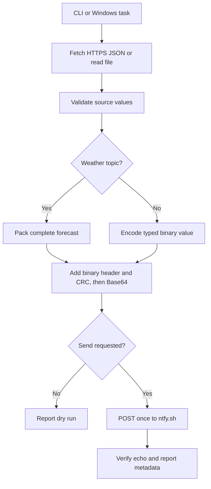

# Notification publisher

[publisher.py](publisher.py) fetches JSON on a computer, encodes it with the project's XWR binary protocol through [binary_protocol.py](binary_protocol.py), and sends a bounded notification through ntfy to the paired watch. Weather uses the shared normalizer in [upload_weather.py](../../project/tools/upload_weather.py) and a compact payload containing current conditions, 24 hourly forecasts and seven daily summaries. Other sources use their own topic and retain a typed value on the watch. The [relay guide](../README.md) describes phone pairing and watch acceptance, while the [protocol specification](../PROTOCOL.md) defines the packet and parsers.

`publisher.py` uses the standard library and requires Python 3.9 or newer. Its weather adapter also needs `project/tools/upload_weather.py` and [america_new_york.tzif](../../project/tools/data/america_new_york.tzif), so retain the workspace layout. [prepare_pc.ps1](prepare_pc.ps1) stores the channel, [run_pc.ps1](run_pc.ps1) runs weather with bounded logs, and [schedule_pc.ps1](schedule_pc.ps1) manages Task Scheduler registration. Direct Python commands provide the publisher and foreground loop on macOS and Linux; neither has a supplied service installer. Windows has passed end-to-end device checks, while macOS and Linux execution remains unverified on those hosts.

## Select an interpreter and check a source

Run commands from the repository root. On Windows, use PowerShell with PlatformIO's interpreter. If PlatformIO uses a custom core directory, substitute its installed Python path.

```powershell
$publisherPython = Join-Path $env:USERPROFILE '.platformio\penv\Scripts\python.exe'
& $publisherPython --version
& $publisherPython -B relay/publisher/publisher.py --weather
```

On macOS or Linux, use an installed Python 3.9-or-newer interpreter. PlatformIO's default interpreter is also available at `$HOME/.platformio/penv/bin/python` after installation.

```bash
python3 --version
python3 -B relay/publisher/publisher.py --weather
```

The command fetches ZIP 10018 weather, validates it and prints the envelope length and fingerprint. Without `--send`, it does not publish. Add `--output weather_preview.txt` to save the complete `XW1:` notification text locally; the file is overwritten on each invocation. Parse that file with the following command. On Windows, substitute `& $publisherPython` for `python3`. Remove preview files when no longer needed.

```bash
python3 -B relay/publisher/binary_protocol.py weather_preview.txt
```

[binary_protocol.py](binary_protocol.py) prints a diagnostic JSON representation for inspection; the transmitted envelope remains binary under Base64. Its weather payload appears as `$bytes_hex` because packed weather validation belongs to `publisher.py`, with receiver expansion in [packed_weather.cpp](../../project/src/packed_weather.cpp) and semantic checks in [phone_protocol.cpp](../../project/src/phone_protocol.cpp). `binary_protocol.py` accepts `--raw` for an unwrapped binary packet and standard input when no filename is supplied. Each invocation accepts one message, with at most one final LF or CRLF in text mode.

A successful parse establishes packet structure, checksum and typed-value validity. It does not establish a fresh weather forecast or watch acceptance. `publisher.py` performs weather checks before publication, while `phone_protocol.cpp` validates received weather semantics and [notification_protocol.cpp](../../project/src/notification_protocol.cpp) checks notification time before committing. The [fixed protocol vector](../PROTOCOL.md#interoperability-vector) provides a local parser check without fetching weather or using the network.

Generic sources accept a local UTF-8 JSON file or public HTTPS endpoint. Supply an existing `payload.json`, or replace the illustrative URL with a real JSON source. On Windows, use `& $publisherPython` in place of `python3`.

```bash
python3 -B relay/publisher/publisher.py --file payload.json --topic notes
python3 -B relay/publisher/publisher.py --url https://example.com/data.json --topic scores
```

URLs must use HTTPS port 443 without embedded credentials, fragments or redirects. Source input is bounded to 256 KiB; the notification body is separately limited to 256 bytes. XWR permits a 189-byte binary packet with a 15-byte fixed overhead plus the topic. A one-character topic leaves 173 bytes for the typed payload, including its tags and lengths. Weather occupies 192 notification bytes. Integer values outside ±9,007,199,254,740,991 remain rejected by the JSON source reader; direct binary codec calls support signed 64-bit integers. Duplicate keys, malformed Unicode, nonfinite numbers and excessive nesting fail before publication. The publisher rejects oversized data rather than splitting it into notifications.

## Prepare the subscription

On Windows, [prepare_pc.ps1](prepare_pc.ps1) creates `relay/publisher/.local/ntfy_topic.txt` only if absent and reuses an existing valid value. `-CopyTopic` copies the channel to the clipboard. This command sends nothing and creates no task.

```powershell
powershell.exe -NoProfile -ExecutionPolicy Bypass -File .\relay\publisher\prepare_pc.ps1 -CopyTopic
```

Subscribe to that value on `https://ntfy.sh` in the iPhone app, then complete the [phone setup](../README.md#connect-the-phone-and-watch). Keep `.local/` private and excluded from version control. The ntfy channel identifies the subscription and differs from the packet's data topic such as `weather`.

If the subscription name is forgotten, run `prepare_pc.ps1` with `-CopyTopic` again. It recovers the value from `relay/publisher/.local/ntfy_topic.txt` without replacing it. Use that value in the phone subscription; changing protocol format does not require a new channel. If that file no longer exists, `prepare_pc.ps1` creates a different channel and the phone subscription must be changed to match.

For direct Python use on any supported host, generate a random channel once and retain it in private local storage. The publisher requires 32–64 letters, digits, underscores or hyphens. This command generates an accepted value; on Windows, substitute `& $publisherPython` for `python3`. Reuse the same value after restarting the terminal so the phone subscription still matches.

```bash
python3 -c "import secrets; print(secrets.token_urlsafe(32))"
```

After subscribing, load the channel into the terminal environment. PowerShell can prompt without putting the value in command history, although `Read-Host` displays the input while it is entered.

```powershell
$env:NTFY_TOPIC = Read-Host 'Enter the existing ntfy channel'
```

The following command prompts without echoing the value in macOS zsh or Linux bash and stores it in the current shell environment and child processes.

```bash
export NTFY_TOPIC="$(python3 -c 'import getpass; print(getpass.getpass("ntfy channel: "))')"
```

An unreserved public channel permits anyone who knows its name to publish or subscribe. Random names limit accidental discovery but do not authenticate the publisher or provide end-to-end encryption. This configuration serves nonsensitive data such as public weather. [ntfy topic documentation](https://docs.ntfy.sh/publish/#picking-a-topic)

## Send one update

With Windows setup complete, check [run_pc.ps1](run_pc.ps1) without publishing, then send once after the phone and watch are ready.

```powershell
powershell.exe -NoProfile -ExecutionPolicy Bypass -File .\relay\publisher\run_pc.ps1 -DryRun
powershell.exe -NoProfile -ExecutionPolicy Bypass -File .\relay\publisher\run_pc.ps1
```

`run_pc.ps1` passes the stored channel through its child process environment and runs weather only. It retains bounded `latest.log` and `previous.log` files in `.local/`, leaves the parent environment unchanged and stops the child after 90 seconds. A direct invocation accepts `-PythonPath` for another interpreter location. Its default `-WireFormat binary` matches the new firmware; `-WireFormat json` supports an older firmware installation during migration.

Direct Python publication reads `NTFY_TOPIC` and requires `--send`. Use the command for the current shell.

```powershell
& $publisherPython -B relay/publisher/publisher.py --weather --send
```

```bash
python3 -B relay/publisher/publisher.py --weather --send
```

Logs report data topic, UTC sequence, body length and FNV-1a fingerprint without printing the channel, source URL or payload. Success means ntfy echoed the complete message; it does not prove watch acceptance. Compare the result with USB `ANCS`, `RELAY` and `WEATHER` fields as described in the [relay guide](../README.md#run-and-inspect-delivery).

The October 19, 2026 delivery check published a 192-byte XWR weather body with sequence `1792456927` and FNV-1a fingerprint `F0A302BE`. The watch reported the same sequence, length and fingerprint, one accepted update, zero ANCS errors or rejections, and 24 hourly plus seven daily records. This check did not record the phone's lock state or repeat a visual screen check. Earlier locked-phone checks used the legacy JSON envelope; ongoing 15-minute delivery and reconnection behavior remain separate verification work.

Upload the binary-capable firmware before switching an older installation to the default publisher format. USB status reports `binary_v=1` when that support is present. The explicit `--wire-format json` option retains the older 240-byte weather envelope during migration. The new receiver accepts both formats, and they share topic sequence history; sending the same sequence in both formats produces a duplicate rather than two updates.

Keep the computer clock and watch RTC accurate. The program uses current Unix UTC seconds as the sequence, and the watch rejects notifications more than 15 minutes old or five minutes ahead. Sending the same topic twice within one second produces a duplicate sequence. An uncertain POST is not retried immediately because the server may already have accepted it.

## Repeat every 15 minutes

The foreground loop in [publisher.py](publisher.py) fetches fresh data for every attempt and remains attached to the terminal. It requires `--send`; repeated dry runs are unavailable. Start the appropriate command after loading `NTFY_TOPIC`.

```powershell
& $publisherPython -B relay/publisher/publisher.py --weather --send --interval 900
```

```bash
python3 -B relay/publisher/publisher.py --weather --send --interval 900
```

Keep the terminal and computer running. Ctrl+C stops the loop. A source-validation failure sends no update, and the next interval fetches fresh data without replaying a backlog. A failed or uncertain POST can occur after ntfy accepts a message, so a publisher error does not establish nondelivery. Sleep, shutdown or process termination interrupts publication. The iPhone may remain locked while notifications and Bluetooth sharing remain available. These commands install neither a macOS launch agent nor a Linux systemd unit.

For unattended Windows operation, [schedule_pc.ps1](schedule_pc.ps1) registers a task for the current user without requiring an administrator account or stored password. It requires PlatformIO's default interpreter at `%USERPROFILE%\.platformio\penv\Scripts\python.exe`; unlike `run_pc.ps1`, it has no interpreter-path option. Run `prepare_pc.ps1` first, then install the task.

```powershell
powershell.exe -NoProfile -ExecutionPolicy Bypass -File .\relay\publisher\schedule_pc.ps1 -Action Install
```

A new installation starts disabled. Repeating installation preserves its existing enabled state. The task name remains `XIAO Watch JSON Relay - <Windows SID>`, and its action runs `run_pc.ps1` in a hidden PowerShell window. That retained name does not select the wire format: `run_pc.ps1` defaults to binary for scheduled runs too. `schedule_pc.ps1` has no format parameter; the explicit `run_pc.ps1 -WireFormat json` option applies to manual migration commands. `schedule_pc.ps1` refuses to alter a task whose owner, command or workspace marker differs.

Enable the task after a manual publication has reached the watch.

```powershell
powershell.exe -NoProfile -ExecutionPolicy Bypass -File .\relay\publisher\schedule_pc.ps1 -Action Enable
```

The task repeats every 15 minutes, also attempts an update at login, and allows Windows to recover a missed run. It ignores overlapping instances, applies a two-minute deadline and can run on battery power. The current user must remain signed in; locking the computer is allowed. The task does not wake a sleeping computer. Enabling it can start a due or missed attempt immediately.

Inspect state and recent results without publishing through the status action.

```powershell
powershell.exe -NoProfile -ExecutionPolicy Bypass -File .\relay\publisher\schedule_pc.ps1 -Action Status
```

Pause attempts with `Disable`, or remove the task registration with `Remove`. Each stops a running instance as well as future attempts. Removal preserves the channel and logs. Neither recalls notifications already sent.

```powershell
powershell.exe -NoProfile -ExecutionPolicy Bypass -File .\relay\publisher\schedule_pc.ps1 -Action Disable
powershell.exe -NoProfile -ExecutionPolicy Bypass -File .\relay\publisher\schedule_pc.ps1 -Action Remove
```

Run either the task or foreground loop for each source. A 15-minute source uses 96 notifications per day before manual or login attempts; two use 192. The documented ntfy.sh daily limit is 250, and other traffic or shared-IP rate limits can reduce the available allowance. The continuous publisher therefore permits at most two sources. It does not reserve quota or guarantee arrival times. [ntfy limits](https://docs.ntfy.sh/publish/#limitations)

## Configure generic sources

Copy [sources_example.json](sources_example.json) to a private file such as `relay/publisher/.local/sources_local.json`. Its `sources` array accepts one to eight unique topics for a one-shot run. Weather uses exactly `topic` and `adapter`; other sources use exactly `topic` and `url`. Replace the illustrative URL before running this example.

```json
{
  "sources": [
    {"topic": "weather", "adapter": "weather"},
    {"topic": "scores", "url": "https://example.com/data.json"}
  ]
}
```

Validate without sending, then add `--send --interval 900` for the two-source loop. On Windows, substitute `& $publisherPython` for `python3`.

```bash
python3 -B relay/publisher/publisher.py --config relay/publisher/.local/sources_local.json
python3 -B relay/publisher/publisher.py --config relay/publisher/.local/sources_local.json --send --interval 900
```

`messages` in [publisher.py](publisher.py) fetches and validates all sources before publishing the first message. Preparation failure sends none from that attempt. Once publication begins, a later send can fail after an earlier message reached ntfy. Each topic has independent sequence history in `phone_protocol.cpp`, but unknown topics share one latest-payload cache declared in [watch_model.h](../../project/include/watch_model.h). A `scores` value does not add a soccer screen or interpret a provider-specific schema.

The Windows scheduled launcher, `run_pc.ps1`, sends weather only and does not load `sources_local.json`. Keep its scheduled task disabled when the configuration loop also sends weather. Added providers must permit the intended use separately; the generic fetcher in `publisher.py` supplies no header-based authentication, response transformation or secret-management option.

## Publisher implementation

`fetch_weather` in [publisher.py](publisher.py) shares coordinates, timezone handling, validation and daily icon selection with [upload_weather.py](../../project/tools/upload_weather.py). It requests current conditions and enough hourly data for 24 hourly forecasts and today plus six following local dates. `pack_weather` in `publisher.py` preserves Celsius tenths, WMO codes and daylight-saving boundaries without dropping forecasts. The [relay format](../README.md#weather-adapter) specifies its 118-byte payload and receiver checks.

| Component | Function |
| --- | --- |
| [`publisher.py`](publisher.py) | It validates input, builds envelopes, optionally publishes them and runs an explicitly requested foreground loop. |
| [`binary_protocol.py`](binary_protocol.py) | It encodes XWR packets, validates CRC32 and typed values, and parses raw packets or notification text for inspection. |
| [prepare_pc.ps1](prepare_pc.ps1) | It creates or reuses the random channel without sending or scheduling. |
| [run_pc.ps1](run_pc.ps1) | It runs one weather attempt with a private child environment, deadline and rotated logs. |
| [schedule_pc.ps1](schedule_pc.ps1) | It installs, enables, disables, removes or inspects the Windows task. |
| [sources_example.json](sources_example.json) | It demonstrates the supported weather-adapter and generic-URL configuration. |
| [upload_weather.py](../../project/tools/upload_weather.py) | It supplies the shared weather normalizer and timezone handling used before packing. |



Publications use title `XIAO Relay v1`, priority `3` and `XW1:` followed by canonical Base64 without a terminating LF. Weather occupies 192 bytes, 20 percent less than the older 240-byte JSON envelope. The program enforces a 256-byte body ceiling because larger bodies were truncated on the tested phone route; this bound differs from ntfy's server limit and the watch's larger legacy NUS transport. Its estimated escaped APNS payload is limited to 3,500 bytes. CRC32 detects accidental corruption without authenticating the sender or encrypting data.

Weather data comes from [Open-Meteo](https://open-meteo.com/) under [CC BY 4.0](https://creativecommons.org/licenses/by/4.0/). The free API permits noncommercial use within its service limits, which covers this personal project. A commercial deployment must review the provider's terms. This path requires no API key or third-party Python package. [Open-Meteo terms](https://open-meteo.com/en/terms)
